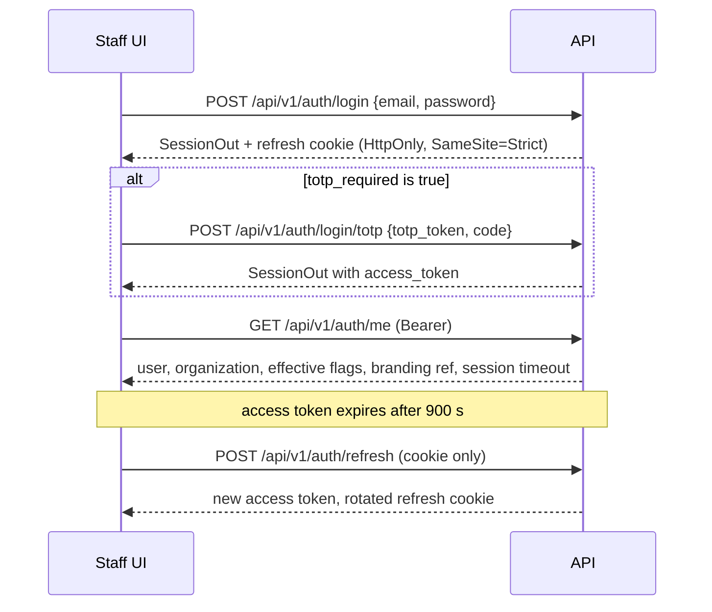

# Frontend handover: assessment platform backend

Start here if you build the web UI. It tells you what exists, where each document lives, how to run the API and Swagger on your machine, and the contracts you must code against. The engineering and operations detail is in [`HANDOVER.md`](HANDOVER.md).

> **Please read this document carefully before forwarding it to anyone outside the team.** It points at demo accounts and security behaviour meant for the engineering team.

> **Review note on the diagram.** The Mermaid diagram below was produced with AI assistance. AI can make mistakes: check it against the Swagger UI and the code before relying on it.

| | |
|---|---|
| Backend repo | `/Users/apple/Documents/my works/hr portal - BE/hr-assessment-backend` (branch `build/one-shot`) |
| Docs folder | `/Users/apple/Documents/my works/hr portal - BE/hr-assessment-backend/docs` |
| API size | 192 operations, 24 Swagger groups, all under `/api/v1` except `/health`, `/health/ready`, `/version`, `/metrics` |
| Stack | Python 3.12, FastAPI, PostgreSQL 16, Docker Compose |

---

## 1. Which document to read for what

All paths are inside the docs folder above unless noted.

| You need | Read | Notes |
|---|---|---|
| Every endpoint, request and response shape | **Swagger UI** (section 2) or `openapi.json` | The contract. Each operation lists its roles (`x-roles`), feature flag (`x-required-flag`), examples and error responses |
| A browsable API page that needs no server | `swagger.html` | Double-click to open. Read-only, needs internet to load Swagger UI |
| Every error code and its message key | `error_codes.md` | 44 codes plus `INTERNAL_ERROR`; you map `message_key` to your own `en.json` |
| Roles, feature flags, jobs, endpoint index by module | `HANDOVER.md` sections 4, 5, 8 | Generated from the code |
| Full backend setup, environment variables, security notes | `HANDOVER.md` | Backend engineers |
| Demo accounts and seeded data | `../seed/README.md` | Use these to click through the UI |
| What was verified live and how | `smoke_report.md`, and `../scripts/smoke_e2e.py` | The e2e script is an executable example of the whole flow in call order |
| Product rules and decisions | `spec/MASTER-SPEC.md` | Binding spec; section 6 lists the endpoints per module |
| Current build status, open decisions | `BUILD-STATE.md` | |

---

## 2. Run the API and Swagger locally

You need Docker Desktop running. Run everything from the repository root.

### 2.1 First time

1. Copy the environment template and fill in the secrets (the full instructions for generating them are in `HANDOVER.md` section 2.2):
   `cp .env.example .env`
   For local use set `APP_ENV=dev`. Signing and encryption need `JWT_PRIVATE_KEY`, `JWT_PUBLIC_KEY`, `FIELD_ENCRYPTION_KEYS` and `TOKEN_PEPPER`; login and the exam need them to work.
2. Start the database and the API:
   `docker compose -f docker/docker-compose.yml up --build -d db api`
   On start the container waits for the database, applies migrations, creates the default super admin from `DEFAULT_SA_*`, then serves.
3. (Optional) load demo data so there is something to look at:
   `docker compose -f docker/docker-compose.yml run --rm api python -m app.cli seed-demo`

### 2.2 Open Swagger

| URL | What |
|---|---|
| `http://localhost:8000/docs` | Swagger UI, **Try it out is enabled** |
| `http://localhost:8000/redoc` | ReDoc, read-only, good for reading |
| `http://localhost:8000/openapi.json` | The raw OpenAPI 3.1 document. Import it into Postman, Insomnia or a client generator |
| `http://localhost:8000/health` and `/health/ready` | Liveness and readiness |

Change the port with `API_PORT`. Swagger, ReDoc and `openapi.json` are **off when `APP_ENV=prod`** unless `ENABLE_DOCS=true`; use the exported `openapi.json` or `swagger.html` for production reference.

### 2.3 Call protected endpoints from Swagger

1. Open `POST /api/v1/auth/login`, choose **Try it out**, send `{"email": "...", "password": "..."}`. Use a demo account from `../seed/README.md` (all share the demo password in that file).
2. Copy `access_token` from the response.
3. Click **Authorize** (top right), paste the token into `bearerAuth`, and confirm. Every staff request now carries `Authorization: Bearer <token>`.
4. The access token lives 15 minutes (`expires_in: 900`). Swagger cannot refresh it for you: log in again. If the response says `totp_required`, send the `totp_token` and your code to `POST /api/v1/auth/login/totp`.
5. For the candidate exam use `examSession` instead: call `POST /api/v1/exam/session/open` with the invite token, then paste the returned `session_token` into `examSession`. The browser-binding cookie is set automatically by the browser (`exam_binding`).

### 2.4 Regenerate after an API change

```
docker compose -f docker/docker-compose.yml run --rm -e APP_NAME="Assessment Platform API" api python -m app.cli export-openapi
python3 scripts/build_swagger_html.py
```

The first command rewrites `docs/openapi.json`, the second rebuilds `docs/swagger.html`. `APP_NAME` is overridden only because the name check forbids the default product name in `docs/`.

### 2.5 Stop and reset

`docker compose -f docker/docker-compose.yml down` stops it. Add `-v` to also delete the database. `... run --rm api python -m app.cli reset-demo` wipes and re-creates only the demo data.

---

## 3. Core contracts to code against

### 3.1 Roles and who sees what

| Role | Value | Scope |
|---|---|---|
| Super admin | `super_admin` | The platform: organizations, platform audit and reports, feature flags, platform branding. Routes under `/api/v1/platform/...` |
| Organization admin | `org_admin` | One organization: team, settings, branding, documents, everything HR can do |
| HR user | `hr_user` | Roles, invites, assessments, review and decisions inside the organization |
| Candidate | `candidate` | Only `/api/v1/exam/...` with an exam token. There are no candidate accounts |

An operation's allowed roles are in Swagger as `x-roles`. Calling it with another role returns `403 FORBIDDEN`. A resource that belongs to another organization returns `404 NOT_FOUND`, never 403.

### 3.2 Staff sign-in and session



- `SessionOut` fields: `access_token`, `token_type` ("bearer"), `expires_in` (seconds), `must_change_password`, `totp_required`, `totp_token`, `totp_setup_required`, `user`.
- Send the access token as `Authorization: Bearer <token>`. Keep it in memory, not in local storage.
- The refresh token is an **HttpOnly cookie scoped to the path `/api/v1/auth`**. Call `/auth/refresh` and `/auth/logout` with `credentials: "include"` and the same site setup, and the browser sends it. JavaScript cannot read it. It rotates on every refresh; reusing an old one revokes the session.
- `must_change_password: true` means only `/auth/change-password`, `/auth/me` and `/auth/logout` work; every other call returns `403 MUST_CHANGE_PASSWORD`. Send the user to a change-password screen first.
- `totp_setup_required: true` means the organization requires an authenticator app and this admin has none; show the TOTP setup flow (`/auth/totp/setup`, then `/auth/totp/verify`; the verify response shows recovery codes **once**).
- Five failed logins lock the account for 15 minutes (`ACCOUNT_LOCKED`). Google sign-in is `POST /api/v1/auth/google` with `{id_token}`, and works only when the organization has it enabled.
- `/auth/me` returns the effective feature `flags` for the user. Hide menu items whose flag is false; the server also blocks them with `403 FEATURE_DISABLED` (`details.flag` names the flag).
- Use `session_timeout_minutes` from `/auth/me` for the idle timeout in the UI.
- Production: the backend must be served over HTTPS with a matching `CORS_ORIGINS` (credentials are allowed, so never `*`) and `COOKIE_SECURE=true`. Locally the default allowed origin is `http://localhost:3000`.

### 3.3 Candidate exam session

- The invite link is `{APP_BASE_URL}/exam/<token>`. Your frontend owns the `/exam/:token` route and calls the API.
- Order: `POST /exam/session/open {token}` (returns `session_token`, `expires_in_sec`) then `GET /exam/session/state`, `POST /exam/session/system-check`, `POST /exam/session/consent`, `POST /exam/session/baseline-photo` (when camera is required), `POST /exam/session/start`, then `GET /exam/questions`.
- Every call after `open` sends `Authorization: Bearer <session_token>` **and** the `exam_binding` cookie (HttpOnly, path `/api/v1/exam`, so use `credentials: "include"`). Another browser gets `LINK_BOUND_TO_OTHER_SESSION` until HR resets the binding.
- During the exam: `PUT /exam/answers/{question_id}` (idempotent, body `{"answer": ...}`), `POST /exam/heartbeat`, `POST /exam/events` (proctoring events), `POST /exam/snapshots` (camera frames), `POST /exam/help-requests`, finally `POST /exam/submit`.
- Answer shapes by question type: single choice `{"option_id"}`, multi choice `{"option_ids": []}`, fill blank `{"blanks": []}`, code gap `{"gaps": []}`, short answer `{"text"}`.
- **The server clock is the only clock.** Show `remaining_seconds` from the state, questions or heartbeat responses and never trust the browser time. Submitting is always accepted, even after the deadline, and a repeated submit returns the same result. The worker also auto-submits expired attempts.
- The device must be a desktop browser with a viewport of at least 900 px wide; otherwise `DEVICE_NOT_SUPPORTED`. A missing camera permission gives `CAMERA_REQUIRED` unless HR granted an exemption (candidate raises a help request).
- Watermark text comes from `state.watermark` (null when the flag is off). Branding and the consent document come in the same state response.

### 3.4 Errors

Every error has the same envelope, on every endpoint:

```json
{ "error": { "code": "DUPLICATE_INVITE", "message_key": "errors.invite.duplicate",
             "details": {"existing_invite_id": "..."}, "request_id": "..." } }
```

- The backend returns **codes and message keys, never display text**. Keep a translation file keyed by `message_key`. The full list is in `error_codes.md`.
- `422 VALIDATION_ERROR` has `details.fields = [{"field": "<path>", "code": "<field code>"}]`; the field codes (`required`, `too_short`, ...) are also message keys.
- `429 RATE_LIMITED` has `details.retry_after_sec` and a `Retry-After` header. Show a wait message.
- `X-Request-ID` is returned on every response and equals `error.request_id`. Show it on error screens so support can find the logs.
- Audit and report exports can fail with `VALIDATION_ERROR` (`too_many_rows`) or `REPORT_FILTER_INVALID` (row caps: 50,000 CSV rows, 2,000 PDF rows); handle both.

### 3.5 Lists, paging, sorting

Every list takes `page` (from 1), `page_size` (default 20, max 100; larger gives `VALIDATION_ERROR`) and `sort=field:asc|desc` (comma-separated for several keys; unknown fields are rejected). The response is:

```json
{ "items": [], "total": 0, "page": 1, "page_size": 20 }
```

### 3.6 Files and images

Logos, documents, snapshots and exports are served through short-lived signed URLs (`/api/v1/files/<token>`) that the API puts into responses. Do not build or cache these URLs; use them as returned and refetch the parent resource when one expires. Uploads are limited to `MAX_UPLOAD_MB` (default 5 MB) and a type allow-list; violations return `UPLOAD_INVALID` with `details.reason`.

### 3.7 Branding and themes

The theme a user should see is read from the endpoint named in `/auth/me` `branding.endpoint` (`/api/v1/platform/branding` for super admins, `/api/v1/org/branding` for org admins). Candidates get branding inside the exam state.

---

## 4. Screens to endpoint map

Swagger groups (tags) are in brackets. Exact paths, bodies and responses are in Swagger.

| Screen area | Who | Swagger groups |
|---|---|---|
| Sign-in, change password, TOTP | all staff | `auth` |
| Organizations, org admins, feature flags, platform branding | super admin | `platform` |
| Team (HR users) | org admin | `team` |
| Organization settings, security, retention, invite defaults | org admin | `org-settings` |
| SMTP email, AI provider, branding, policy documents | org admin | `org-email`, `org-ai`, `org-branding`, `org-documents` |
| Assessments: versions, questions, preview, publish | org admin, HR | `assessments`, `ai` (AI question generation), `question-bank` |
| Open roles and linking an assessment | org admin, HR | `roles` |
| Invites, bulk CSV, email, accommodations, help requests | org admin, HR | `invites`, `help-requests` |
| Candidate exam | candidate | `exam` |
| Review of an attempt, scoring, decisions, erase candidate data | org admin, HR | `review` |
| Dashboard gadgets, layout, notifications | staff | `dashboard`, `notifications` |
| Reports chat (AI, org) and platform reports | org admin / super admin | `reports`, `reports (platform)` |
| Audit search and export | org admin / super admin | `audit`, `audit (platform)` |
| Health, version, file download | public | `health`, `files` |

### 4.1 Things the UI must know about

- **Assessment versions:** at most 3 versions per assessment; a role links to a published version.
- **Regenerating an invite link keeps the candidate's browser binding** (by design in the spec). A new browser still needs HR to reset the binding, so offer a **Reset binding** action next to **Regenerate link**.
- **Role close** automatically revokes unstarted invites. A **disabled organization** cannot start new exams (running attempts can finish).
- **Scoring:** objective questions are scored on submit. AI scoring is deferred to a background job (every 5 minutes), so a scored-pending state exists; if AI is unavailable or off, the attempt becomes `needs_manual` and the owner is notified.
- **AI features** (question generation, scoring, reports chat) need the organization's AI provider and the matching flag. The demo and tests use a mock provider.
- **Reports chat:** super admins have no AI, so their report call sends a structured `filter_spec` instead of a prompt. Report history is organization-wide.
- **Reports:** the flow is interpret, select, preview-count, generate, then download through the report's download endpoint (see the `reports` group). Generated report files are deleted after 7 days; the request stays in the history list.
- **Dates** are ISO 8601 UTC; render them in the organization's timezone (`organization.timezone` from `/auth/me`).

---

## 5. Demo logins for the UI

After `seed-demo` (details in `../seed/README.md`): the demo super admin, two organization admins (one organization with every flag on, one with camera proctoring, bulk invite, reports chat, AI builder, AI scoring and the question bank off) and several HR users, plus 20 invites in every state, 13 submitted attempts, and 9 decisions. Candidate links are not listed (only hashes are stored): sign in as demo HR, open an invited candidate and regenerate the link. The demo seed is refused when `APP_ENV=prod`.

---

## 6. Working rules for developers and AI agents (use these first)

These rules are also in the repo's `CLAUDE.md`, so Claude Code loads them at the start of every session.

1. **Use the brain MCP for all code analysis.** The code index is built with brain (`project-brain`, command `brain`). In Claude Code the MCP tools are `brain_context` (best first call: describe the task), `brain_search`, `brain_expand` (callers and callees), `brain_read` (exact line range), `brain_check` (blast radius and test coverage before editing a symbol), `brain_build` and `brain_list`. Do not grep or list folders to find code.
   - The MCP server is registered per project: `claude mcp add brain -- <node 24 path> <project-brain path>/bin/brain.js mcp`. The registered command uses the Node 24 binary from nvm.
   - If you use the CLI, put Node 24 first on the path: `PATH=/Users/apple/.nvm/versions/node/v24.20.0/bin:$PATH brain context "<task>"`. The default `node` on this machine is v18, which crashes brain's native database module (exit code 139).
   - Run `brain build` after edits. It is incremental and takes seconds. The index lives in `~/.brains/hr-assessment-backend-afe4aca1`.
2. **Read and write files with Claude's built-in tools** (Read, Write, Edit), **not shell scripts.** `cat`, `sed`, `echo`, heredocs and inline `python -` snippets send large outputs through the terminal and cost far more tokens. Use Read with line ranges, Edit for small changes, Write for new files. Use the shell only to run things: Docker, pytest, git, brain.
3. **Keep verification light.** Run only the tests of the module you touched; check behaviour through Swagger or `scripts/smoke_*.py`; run the full test suite once at the end of a round.

---

## 7. Known limits to design around

- Access tokens stay valid up to 15 minutes after logout (log out everywhere, `/auth/logout-all`, invalidates at once).
- One JWT signing key at a time; rotating it signs everyone out.
- The "require authenticator app for admins" organization setting is reported through `totp_setup_required` but is not enforced on login.
- Two things need real third-party credentials and were verified only offline: Google sign-in, SMTP relay and S3 storage. AI was exercised with a mock provider only.
- Full list of accepted risks and open decisions: `HANDOVER.md` section 10.3 and Appendix B.
