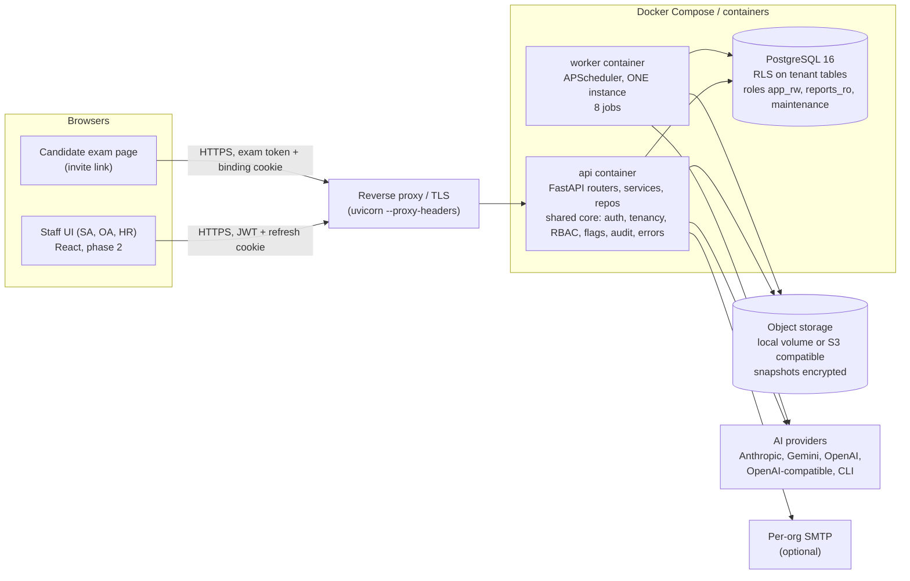
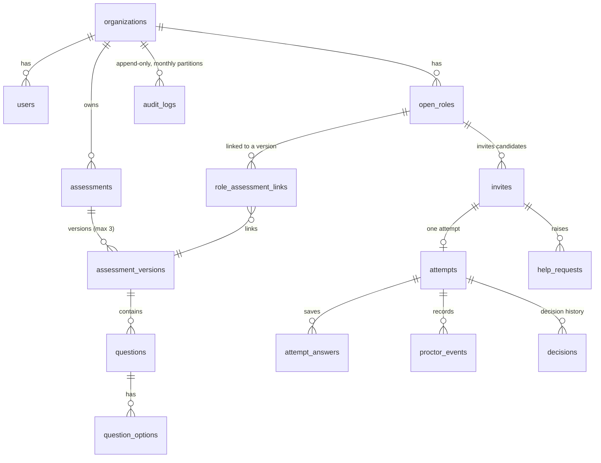
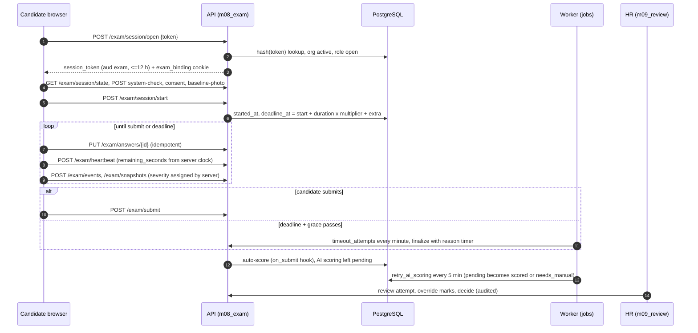

# Handover: assessment platform backend

| | |
|---|---|
| Repository | `hr-assessment-backend` (branch `build/one-shot`) |
| Stack | Python 3.12, FastAPI, PostgreSQL 16 (SQLAlchemy 2 async, Alembic), Docker Compose |
| API size | 191 operations on 157 paths, 12 modules (M1 to M12 plus the question bank and AI), 8 background jobs, 22 feature flags |
| Spec | `docs/spec/MASTER-SPEC.md` (decision register and build specification) |
| API reference | `docs/openapi.json` (also served at `/docs` and `/openapi.json` by a running instance) |
| Companion documents | `docs/error_codes.md`, `docs/test_report.md`, `docs/smoke_report.md`, `seed/README.md`, `app/core/README.md`, `docs/BUILD-STATE.md` |

> **Please read this document carefully before forwarding it to anyone outside the team.** It lists residual security risks and open decisions that are meant for the owner and the engineering team.

> **Review note on the diagrams.** The Mermaid diagrams in this document (architecture, entity relationships, exam sequence) were produced with AI assistance. AI can make mistakes. Review them carefully against the code and the spec before relying on them or putting them in client material.

## How this document was produced

Written from the code and the build ledger on the day of the final build pass. Where the code is the source of truth the tables were **generated**, not typed:

| Section | Generated from | Regenerate with |
|---|---|---|
| 4 Feature flags | `migrations/versions/0002_seed_catalogs.py`, `app/core/flags.py`, `x-required-flag` in the OpenAPI | read the migration and the flag module |
| 5 Endpoint index | `docs/openapi.json` (`x-roles`, `x-required-flag`) | `docker compose -f docker/docker-compose.yml run --rm -e APP_NAME="Assessment Platform API" api python -m app.cli export-openapi` |
| 6 Error codes | `ERROR_CODES` in `app/core/errors.py` | see `docs/error_codes.md` |
| 8 Jobs | `app/jobs.JOBS` and `app/jobs/scheduler.py` `SCHEDULES` | `python -m app.cli list-jobs` |
| 11 Tests | `pytest --collect-only -q` (collection only, not a run) | same command |

`docs/openapi.json` is exported with `APP_NAME` overridden, because `scripts/check_name.sh` forbids the default product name anywhere under `docs/` except the spec and plan folders. The exported file was compared with a fresh export at the time of writing: identical.

---

## 1. Overview and architecture

A multi-tenant, proctored online assessment backend. Organizations (tenants) are created by a platform super admin; each organization has an admin and HR users who build assessments (with optional AI help), open roles, invite candidates by link, review submissions with proctoring evidence, and record decisions. Candidates take the exam in a browser through a one-time link; there are no candidate accounts. The frontend is a separate repository (phase 2); this backend is complete without it.

Three levels of access: **Super Admin (SA)** runs the platform, **Organization Admin (OA)** runs one organization, **HR user (HR)** works on roles and candidates. Candidates have a separate token audience (`exam`) that can never be used on staff routes.

### 1.1 System diagram



### 1.2 Layering

1. **Routers** validate input, call a service, shape the response. No business logic.
2. **Services** hold the business rules, call repositories, emit audit events, check flags.
3. **Repositories** are the only code that touches tables; every query filters by `org_id`, and Postgres Row-Level Security is a second layer.
4. Modules talk to each other only through `app/core` or another module's service interface. Cross-module hooks: `m06_roles.hooks.on_role_close` (M7 revokes unstarted invites), `m08_exam.hooks.on_submit` (M9 scores), `m09_review.hooks.ai_scoring_hooks` (M14 AI scoring).

Request path: `RequestIDMiddleware` (outermost, sets `X-Request-ID`) > security headers > CORS > router > guard dependencies (`require_role`, `require_feature`, `require_owner_or_admin`) > service > repository. `DbSession` is one transaction per request with the RLS settings applied; it commits **before** the response is sent and rolls back on any exception, and the audit row is written in the same transaction as the change.

### 1.3 Modules

| Module | Folder | Responsibility | Ops |
|---|---|---|---|
| core | `app/core` | config, DB and tenancy, security, errors, flags, audit, storage, AI interface, export, health | 4 |
| M1 | `m01_auth` | login, refresh rotation, TOTP, Google sign-in, password change, `/auth/me` | 11 |
| M2 | `m02_platform` | organizations, org admins, feature flags, misuse flags, platform branding (SA only) | 26 |
| M3 | `m03_team` | HR users of an organization | 9 |
| M4 | `m04_org_settings` | profile, security, retention, invite defaults, SMTP, AI provider, branding, policy documents | 30 |
| M5 | `m05_assessments` | assessments, versions, questions, preview, publish, 3-version rule | 19 |
| M5b | `m05b_question_bank` | organization question bank | 6 |
| M6 | `m06_roles` | open roles, assessment linking | 13 |
| M7 | `m07_invites` | invites, bulk CSV, email, accommodations, help-request inbox | 13 |
| M8 | `m08_exam` | candidate exam engine, proctoring events, snapshots, timer | 14 |
| M9 | `m09_review` | attempt report, scoring, decisions, flags, erase | 11 |
| M10 | `m10_audit` | audit search and export (organization and platform) | 11 |
| M11 | `m11_reports` | AI report chat, schema-only (organization and platform) | 14 |
| M12 | `m12_dashboard` | 18 gadgets, layouts, notifications | 8 |
| M14 | `m14_ai` | providers, question generation, AI scoring runner | 2 + internals |
| jobs | `app/jobs` | scheduler and 8 jobs | none |

Modules are auto-discovered: `create_app()` includes every `app/modules/*/router.py` and `app/cli.py` loads every `app/modules/*/cli.py`, `app/jobs/cli.py` and `seed/cli.py`.

### 1.4 Tenancy and isolation (what to remember)

- Every tenant table has `org_id`; RLS is `ENABLE` + `FORCE` on the 28 tenant tables (and on child tables that inherit their parent's visibility) with policy `org_id = app_current_org_id() OR app_is_platform()`. Each transaction runs `SET LOCAL ROLE app_rw` and `set_config('app.org_id' / 'app.is_platform', ..., true)`.
- A superuser or `BYPASSRLS` connection skips RLS. This is why the application switches to the `app_rw` role per transaction (`DB_APP_ROLE`); see section 10.1 for production topologies.
- Cross-organization ids return 404, never 403. The live security script checked 68 read/update/delete routes for this (`docs/smoke_report.md`).
- Public pre-auth flows (login, refresh, exam link open) run in platform mode and filter the organization explicitly.

### 1.5 Entity relationships (core tables)

32 tables in total (the full dictionary is section 7). The diagram shows the spine only.



### 1.6 Exam flow (candidate)



---

## 2. How to run

All commands run from the repository root. Docker is the only supported way (tests, CLI and scripts all run in the `api` image).

### 2.1 First run (development)

```sh
cp .env.example .env
# fill in the secrets (see 2.2), at least JWT_PRIVATE_KEY, JWT_PUBLIC_KEY, FIELD_ENCRYPTION_KEYS,
# TOKEN_PEPPER and DEFAULT_SA_*; APP_ENV=dev needs none of them to boot, but nothing that signs or encrypts works without them
docker compose -f docker/docker-compose.yml up --build api worker db
# API on http://localhost:8000  (override with API_PORT), Swagger UI at /docs, health at /health, /health/ready
```

What the `api` container does on start (`docker/entrypoint.sh`, only when the command is `uvicorn`): waits for the database (`DB_WAIT_TIMEOUT_SEC`, default 60 s), runs `alembic upgrade head`, runs `python -m app.cli create-default-superadmin` (idempotent), then starts uvicorn. Any other command (pytest, the worker, ad-hoc CLI) runs untouched. The **worker does not migrate**; start it after the API has migrated.

Other services: `test-db` (disposable Postgres on tmpfs for the test suite; started because `api` depends on it), and under `--profile dev`: `minio` (S3 API 9000, console 9001) and `mailpit` (SMTP 1025, inbox 8025).

Common commands (the CLI is `python -m app.cli`; run any of them with `docker compose -f docker/docker-compose.yml run --rm api <cmd>`):

| Command | Purpose |
|---|---|
| `python -m app.cli --help` | list commands |
| `version` | print the application version |
| `create-default-superadmin` | create the break-glass super admin from `DEFAULT_SA_*` if missing |
| `list-jobs` / `run-job <name>` | list jobs / run one now and print its JSON result |
| `export-openapi [-o path]` | write `docs/openapi.json` (needs no database or secrets) |
| `seed-demo` / `reset-demo` | demo data (refused when `APP_ENV=prod`), see 3.1 |
| `alembic upgrade head` | apply migrations (manual runs) |
| `pytest tests/<module> -q` | one module's tests (see section 11) |
| `sh scripts/check_name.sh` | verify the product/vendor name appears only in `app/core/config.py` |
| `ruff check . && ruff format --check .` | lint (the wrapper `scripts/lint.sh` runs docker itself, so call it from the host) |

An existing development database created before the Wave 1 gate must be recreated (`docker compose -f docker/docker-compose.yml down -v`): the baseline migration was edited (column grants, RLS on `password_history` and `refresh_tokens`) rather than adding a second migration.

### 2.2 Generating the secrets

```sh
# JWT signing key pair (Ed25519; RS256 keys also work). In .env use a quoted single line with \n escapes.
openssl genpkey -algorithm ed25519 -out jwt_private.pem && openssl pkey -in jwt_private.pem -pubout -out jwt_public.pem
# field encryption key: "<key id>:<base64 of 32 random bytes>"; several keys comma separated, FIRST is the active one
python3 -c "import os,base64;print('k1:'+base64.b64encode(os.urandom(32)).decode())"
# token pepper (HMAC key for invite token hashes, refresh token hashes, blind index, signed file URLs)
openssl rand -hex 32
```

`APP_ENV=prod` refuses to start without `TOKEN_PEPPER`, `FIELD_ENCRYPTION_KEYS`, `JWT_PRIVATE_KEY` and `JWT_PUBLIC_KEY`. Never commit `.env`. Losing `FIELD_ENCRYPTION_KEYS` makes every encrypted value (candidate emails and phones, SMTP passwords, AI keys, TOTP secrets, snapshots) unreadable; back the keys up separately from the database.

### 2.3 Environment variables

Defined in `app/core/config.py` (the only place that reads the environment, apart from the migration passwords below). `.env.example` is the template. Names are case-insensitive.

| Variable | Default | Purpose |
|---|---|---|
| `APP_NAME` | default product name in `config.py` | Product name: OpenAPI title, JWT issuer (slugged), refresh-cookie name, PDF headers, email subjects. See "How to rename the product" |
| `APP_VENDOR_NAME` | default vendor name in `config.py` | Vendor name: candidate-page watermark text ("Powered by ..."), demo organization name |
| `APP_ENV` | `dev` | `dev`, `test`, `prod`. `prod` enforces required secrets, the SMTP host DNS guard, and blocks the demo seed. Also makes the exam binding cookie `Secure` |
| `API_BASE_URL` | `http://localhost:8000` | Public API base; used to build signed file URLs (`/api/v1/files/<token>`) |
| `APP_BASE_URL` | `http://localhost:3000` | **Frontend** URL written into every invite link (`{APP_BASE_URL}/exam/<token>`). Moving from a tunnel to a domain is this one line |
| `DATABASE_URL` | local postgres | Main connection (`postgresql+asyncpg://...`). In compose it is overridden to the `db` service |
| `DATABASE_URL_REPORTS_RO` | empty (falls back to `DATABASE_URL`) | Connection for the report engine; the transaction runs as role `reports_ro` |
| `DATABASE_URL_MAINTENANCE` | empty (falls back to `DATABASE_URL`) | Connection for the `audit_partitions` job; the partition functions are executable only by role `maintenance` |
| `DB_APP_ROLE`, `DB_REPORTS_ROLE` | `app_rw`, `reports_ro` | Role switched to with `SET LOCAL ROLE` per transaction. Empty disables the switch (connect directly as that role) |
| `POSTGRES_PASSWORD` | `postgres` | Compose only: password of the `db` service superuser |
| `APP_RW_DB_PASSWORD`, `REPORTS_RO_DB_PASSWORD`, `MAINTENANCE_DB_PASSWORD` | unset | Read **only by the baseline migration**. When set at migration time the role becomes `LOGIN` with that password (12 to 128 characters from `A-Z a-z 0-9 ! # $ % & ( ) * + , . / : ; < = > ? @ ^ _ ~ -`; anything else aborts the migration) |
| `JWT_PRIVATE_KEY`, `JWT_PUBLIC_KEY` | empty | PEM, Ed25519 or RSA; literal `\n` is accepted |
| `JWT_KID` | `k1` | Key id in the token header; **one kid is accepted** (see 10.3) |
| `ACCESS_TTL_MIN`, `REFRESH_TTL_DAYS` | 15, 7 | Token lifetimes (the inactivity timeout is per organization, default 30 min) |
| `FIELD_ENCRYPTION_KEYS` | empty | `<kid>:<base64 32 bytes>`, comma separated, first is active |
| `TOKEN_PEPPER` | empty | HMAC pepper (see 2.2) |
| `ARGON2_TIME_COST`, `ARGON2_MEMORY_KIB`, `ARGON2_PARALLELISM` | 12, 65536, 4 | Password hashing, about 250 ms per hash in the api container |
| `DEFAULT_SA_EMAIL`, `DEFAULT_SA_NAME`, `DEFAULT_SA_PASSWORD` | empty | Break-glass super admin, created on first start. Password must satisfy the policy (12+ characters, not common). All three must be set, otherwise creation is skipped with a message |
| `STORAGE_DRIVER` | `local` | `local` or `s3` |
| `STORAGE_LOCAL_PATH` | `/app/storage_data` | Local driver directory (**must be a persistent volume in production**) |
| `S3_ENDPOINT`, `S3_BUCKET`, `S3_ACCESS_KEY`, `S3_SECRET_KEY`, `S3_REGION` | empty | S3-compatible driver (AWS S3, MinIO, GCS interoperability) |
| `GOOGLE_CLIENT_ID` | empty | Audience for Google ID-token verification; empty means Google sign-in is off |
| `CORS_ORIGINS` | `http://localhost:3000` | Comma-separated allow-list (credentials are allowed, so never `*`) |
| `COOKIE_DOMAIN` | empty | Domain attribute of the refresh cookie |
| `COOKIE_SECURE` | `false` | `Secure` flag of the refresh cookie. **Set `true` behind HTTPS** |
| `AI_CLI_ALLOWLIST`, `AI_CLI_TIMEOUT_SEC` | `claude`, 120 | CLI provider: allowed command keys and hard timeout |
| `AI_REQUEST_TIMEOUT_SEC` | 60 | Timeout for API-mode provider calls (generation, scoring, report chat, connection tests) |
| `MAX_UPLOAD_MB`, `MAX_JD_CHARS` | 5, 8000 | Upload size limit (logos, documents, baseline photo, snapshots); job description length for AI generation |
| `MAX_SNAPSHOT_KB` | 300 | **Defined but not read by any code** at the time of writing (snapshots are limited by `MAX_UPLOAD_MB`); see Appendix B |
| `RATE_LIMIT_LOGIN`, `_EXAM_LINK`, `_EXAM_EVENTS`, `_AI_GENERATE`, `_REPORT_INTERPRET`, `_INVITE_EMAIL` | 10/min, 20/min, 120/min, 5/min, 10/min, 60/hour | slowapi strings. Login and exam-link are per IP, events per attempt, generate and interpret per user, invite email per organization |
| `RATE_LIMIT_SNAPSHOT_INTERVAL_SEC`, `RATE_LIMIT_SNAPSHOT_MAX_PER_ATTEMPT` | 20, 300 | One snapshot per 20 s per attempt, 300 per attempt |
| `LOG_LEVEL` | `INFO` | Python logging level |
| `DEMO_MODE` | `false` | **Defined but not read by any code** at the time of writing; see Appendix B |
| `DEMO_PASSWORD` | `DemoPass#2026` | Seed only: shared password of the demo accounts (must satisfy the policy) |
| `INSTALL_CLAUDE_CLI` | `false` | Compose **build** argument: install the Claude CLI into the image for the CLI AI provider |
| `API_PORT`, `DB_WAIT_TIMEOUT_SEC`, `TEST_DATABASE_URL` | 8000, 60, test-db | Compose port mapping, entrypoint wait, test database |

### 2.4 Migrations

Two revisions in `migrations/versions/`: `0001_baseline` (tables, extensions `citext` and `pgcrypto`, `uuid_generate_v7()`, roles, RLS, audit partitions and functions, triggers, grants) and `0002_seed_catalogs` (22 flags, 18 gadgets; `ON CONFLICT DO NOTHING`, so edited defaults survive a re-run).

- `alembic upgrade head` on an empty database builds everything. It is also what the entrypoint runs on every API start. `alembic downgrade base` works and is tested; the three roles are cluster-wide and are left in place.
- Grants are explicit, not default privileges: **any new table needs its own grant lines** in a later migration (`app_rw`, and `reports_ro` where reports may read it).
- Migrations run with `DATABASE_URL` (`migrations/env.py` has no separate migration URL), so the connecting user must be allowed to create roles and extensions (superuser, or an owner with `CREATEROLE`). See the least-privilege caveat in 10.1.
- Moving to the client's cloud: run migrations on an empty database (the schema builds itself), then start clean or reseed.

### 2.5 First-run behavior

1. `alembic upgrade head`, 2. default super admin created if `DEFAULT_SA_*` are all set (no-op if present; exits 0 when unset so the container still starts; exits 1 on a weak password or an email owned by another account), 3. API starts. The worker, when started, runs `audit_partitions` once so next month's audit partitions exist.
4. Log in as the default super admin (`POST /api/v1/auth/login`), create an organization with its first admin (`POST /api/v1/platform/orgs`; the admin's temporary password is returned **once** in the response and the admin must change it at first login), then continue in the organization.

### 2.6 Deployment notes (spec section 13)

- **HTTPS is mandatory** for the candidate camera (browsers only allow camera access on HTTPS or localhost). For testers on other machines use a tunnel (Cloudflare Tunnel, ngrok) or a small VM with a real domain; `APP_BASE_URL` controls the link domain.
- The shipped compose file is a **development** file: it bind-mounts the source (`..:/app`), publishes the API on all interfaces, starts `test-db`, and exposes no TLS. For a pilot or production copy it, remove the `..:/app` volume lines, add a persistent volume for `/app/storage_data` (or use S3), keep the database port unpublished, and put a TLS reverse proxy in front.
- The API image runs as the non-root user `app` (uid 10001); application code is root-owned and read-only to it, only `/app/storage_data` is writable. `HEALTHCHECK` calls `/health`.
- `GET /health` (liveness, no database), `GET /health/ready` (readiness, `SELECT 1`, 503 when the database is down), `GET /version`.

---

## 3. Accounts and roles

### 3.1 Demo accounts and reseeding

The seed drives the real service layer, so audit entries, notifications and scores are genuine. Full details, content and the exact account list are in `seed/README.md`.

```sh
docker compose -f docker/docker-compose.yml run --rm api python -m app.cli seed-demo    # create (no-op if present)
docker compose -f docker/docker-compose.yml run --rm api python -m app.cli reset-demo   # wipe demo data, then reseed (repeatable)
```

| Account | Email | Role |
|---|---|---|
| Daily super admin | `superadmin.daily@platform.demo.example.com` | super_admin |
| Org 1 admin | `admin@one.demo.example.com` | org_admin |
| Org 1 HR | `hana@`, `ravi@`, `meera@`, `tom@` `one.demo.example.com` | hr_user |
| Org 2 admin | `admin@acme.demo.example.com` | org_admin |
| Org 2 HR | `lena@acme.demo.example.com` | hr_user |

All demo accounts share the demo-only password `DemoPass#2026` (override with `DEMO_PASSWORD`). Org 1 has every feature flag on; org 2 ("Acme Demo Corp") has camera proctoring, CSV bulk invite, reports chat, AI question builder, AI scoring and the question bank off. Content: 4 assessments (5 versions), 6 roles, 20 invites, 15 attempts, 9 decisions, dashboard layouts, activity back-dated over two weeks.

Guards (see also 10.4): `seed-demo`, `reset-demo` and the wipe refuse to run when `APP_ENV=prod` (a hard error inside the seed code, not only in the CLI). The wipe only removes organizations that are flagged `is_demo`, carry the reserved slugs `demo-one` / `acme-demo` and were created by the demo super admin. The audit log is append-only, so audit rows of earlier demo runs remain.

### 3.2 The default (break-glass) super admin

Created from `DEFAULT_SA_*` on first start. Rules, enforced by a database trigger and the service layer:

- cannot be deleted, deactivated, reactivated, reset, unlocked, or have its password or TOTP changed through the API (`PROTECTED_ACCOUNT`); the trigger allows only login bookkeeping columns (`token_version`, `failed_login_count`, `locked_until`, `last_login_at`, `updated_at`) to change;
- created with `must_change_password = false`; every login is audited as `AUTH_LOGIN_SUCCESS` plus `AUTH_DEFAULT_SA_LOGIN`;
- a changed `DEFAULT_SA_PASSWORD` is **not** applied to an existing row. To rotate it, a database superuser must bypass the trigger deliberately (verified on the development database):

```sh
# 1. hash the new password with the application's own parameters
docker compose -f docker/docker-compose.yml run --rm -T api python -c "from app.core.security import hash_password; print(hash_password('<new password>'))"
# 2. as a database superuser
psql -U postgres -d hr_assessment <<'SQL'
BEGIN;
SET LOCAL session_replication_role = replica;   -- bypasses the protection trigger, superuser only
UPDATE users SET password_hash = '<hash from step 1>', token_version = token_version + 1 WHERE is_default_super_admin;
COMMIT;
SQL
```

`token_version + 1` signs out every existing session of that account. Treat this as a break-glass procedure and record it outside the application (the trigger bypass writes no audit row).

### 3.3 Roles and the permission matrix

| Capability | SA | OA | HR (owner) | HR (other) |
|---|---|---|---|---|
| Create or disable organizations | Yes | No | No | No |
| Create, deactivate, reactivate org admins | Yes | No | No | No |
| Feature flags, watermark | Yes | No | No | No |
| Raise or clear misuse flags | Yes | No | No | No |
| Platform branding | Yes | No | No | No |
| Add, edit, deactivate HR users | No | Yes | No | No |
| Org settings, branding, documents, email, AI setup | No | Yes | No | No |
| View audit log | All orgs, read-only | Own org | No | No |
| AI report chat | Org-level aggregates only | Own org | No | No |
| Create assessments and roles | No | Yes | Yes | Yes (own) |
| Edit assessments and roles | No | Yes | Yes | No |
| View assessments and roles | Read-only | Yes | Yes | Read-only |
| Link assessment to role | No | Yes | Yes | No |
| Invite candidates | No | Yes | Yes | No |
| See candidate list and status for a role | Counts only | Yes | Yes | Name, status, decision only |
| See answers, violations, snapshots | **No** | Yes | Yes | No |
| Make decision | No | Override only | Yes | No |
| Approve help requests, grant exemptions | No | Yes | Yes | No |
| Delete candidate data | No | Yes | No | No |
| Use dashboard gadgets | Platform scope | Org scope | Own scope | Own scope |

"Owner" means the owner of the role (or the HR who created the invite). Decision rights: the role owner decides; an OA can override (`/decision/override`); an HR decision stands until an OA overrides. The SA never sees candidate answers or snapshots.

Operations by role in the current OpenAPI (191 in total) (a call is allowed to the roles listed in its `x-roles`):

| Roles | Operations |
|---|---|
| public (no token) | 9: health (3), login, TOTP login, Google login, refresh, exam session open, signed files |
| candidate (exam token) | 13 |
| SA only | 38 |
| OA only | 54 |
| OA and HR | 53 |
| SA, OA and HR | 21 |
| SA and OA | 3 |

Every route also declares `x-required-flag`. The live security script called **every operation with every role that is not in its `x-roles`** and all answered 401/403 (`docs/smoke_report.md`).

Protected-account rules: the last active admin of an organization cannot be deactivated (`LAST_ADMIN_PROTECTED`, on both the SA and OA paths); the default SA is protected (above); an SA cannot act as an OA (`/platform/...` routes are separate from organization routes).

Account basics (M1): login is constant-time with a generic error; 5 failed logins lock the account for 15 minutes (an OA or SA can unlock); first login forces a password change (everything else answers `MUST_CHANGE_PASSWORD`); password policy default is 12 characters minimum, common-password blocklist, no reuse of the last 5 (configurable per organization; the minimum cannot go below 8); optional TOTP for SA and OA with 8 single-use recovery codes; Google sign-in only links to an existing active user whose email domain is in the organization's allowed list (an empty list means Google sign-in is off for that organization). Temporary passwords are random, shown once and never stored or logged.

---

## 4. Feature flag catalog

Flags live in the `feature_flags` table (defaults, edited by the SA through `/api/v1/platform/features/defaults`) with per-organization overrides in `org_feature_flags` (`GET`/`PUT /api/v1/platform/orgs/{org_id}/features`). A disabled flag returns `403 FEATURE_DISABLED` with `details.flag`. The effective map is part of `/auth/me`; flags with `visible_to_org = false` are omitted for non-SA users. Flags are checked **at exam start**, never continuously, so a running exam is never interrupted. SA calls are not flag-gated. Every flag change is audited with the SA's name and an optional reason.

Dependencies are resolved by the service: a flag is effective only if all flags it depends on are effective. Not flaggable (core): authentication and exam execution.

| Key | Controls | Default | Visible to org | Depends on | Endpoints guarded |
|---|---|---|---|---|---|
| `dashboard` | Dashboard | on | yes | - | 4 (notifications API) |
| `dashboard_gadgets` | Customizable dashboard gadgets | on | yes | - | 4 (dashboard gadgets API) |
| `assessments` | Assessments tab and builder | on | yes | - | 19 |
| `ai_question_builder` | AI question suggestions | on | yes | - | 2 |
| `ai_scoring` | AI scoring of short answers and code gaps | on | yes | - | - (checked inside scoring runner, not an endpoint) |
| `question_bank` | Question bank (stretch) | on | yes | - | 6 |
| `roles` | Open roles | on | yes | - | 13 |
| `invites` | Invites | on | yes | roles, assessments | 10 |
| `csv_bulk_invite` | CSV bulk invite | on | yes | invites | 1 |
| `email_sending` | Send links by email (needs SMTP) | on | yes | - | 4 |
| `help_requests` | Candidate help requests | on | yes | - | 3 |
| `camera_proctoring` | Camera checks and snapshots | on | yes | - | - (read at exam start) |
| `review` | Candidate review and decisions | on | yes | - | 11 |
| `reports_chat` | AI report chat (organization side) | on | yes | - | 7 |
| `audit_view` | Audit screen | on | yes | - | 6 |
| `audit_export` | Audit exports | on | yes | - | 1 |
| `team` | Team management | on | yes | - | 9 |
| `settings` | Settings section: organization settings | on | yes | - | 8 |
| `org_branding` | Settings section: organization branding | on | yes | - | 7 |
| `policy_documents` | Settings section: policy documents | on | yes | - | 7 |
| `ai_provider_setup` | Settings section: AI provider setup | on | yes | - | 5 |
| `watermark` | Vendor watermark on candidate pages (SA only) | on | no (SA only) | - | - (not an endpoint guard; controls the watermark text) |


New organizations get the SA-defined default set. The migration seeds all 22 flags as on (`watermark` is hidden from organizations). AI features additionally need an AI provider configured for the organization (not necessarily the `ai_provider_setup` flag); `email_sending` needs verified SMTP.

---

## 5. Endpoint index

191 operations, generated from `docs/openapi.json`. **Roles** are the `x-roles` values (SA super admin, OA organization admin, HR HR user, Candidate exam session, public = no token); **Flag** is `x-required-flag`. All business routes are under `/api/v1`; only `/health`, `/health/ready` and `/version` are outside it. The per-operation request and response examples, error responses and security schemes (`bearerAuth`, `examSession`, `examBindingCookie`) are in Swagger at `/docs`.

#### Core: health and version (3)

| Method | Path | Summary | Roles | Flag |
|---|---|---|---|---|
| GET | `/health` | Liveness check | public | - |
| GET | `/health/ready` | Readiness check | public | - |
| GET | `/version` | Application version | public | - |

#### Core: signed files (1)

| Method | Path | Summary | Roles | Flag |
|---|---|---|---|---|
| GET | `/api/v1/files/{token}` | Download an object through a short-lived signed token | public | - |

#### M1 Authentication and sessions (11)

| Method | Path | Summary | Roles | Flag |
|---|---|---|---|---|
| POST | `/api/v1/auth/login` | Sign in with email and password | public | - |
| POST | `/api/v1/auth/login/totp` | Complete a sign-in with the authenticator code | public | - |
| POST | `/api/v1/auth/google` | Sign in with a Google ID token | public | - |
| POST | `/api/v1/auth/refresh` | Rotate the refresh token and get a new access token | public | - |
| POST | `/api/v1/auth/logout` | Sign out this session | SA, OA, HR | - |
| POST | `/api/v1/auth/logout-all` | Sign out everywhere | SA, OA, HR | - |
| POST | `/api/v1/auth/change-password` | Change the password | SA, OA, HR | - |
| POST | `/api/v1/auth/totp/setup` | Start authenticator-app setup | SA, OA | - |
| POST | `/api/v1/auth/totp/verify` | Confirm authenticator-app setup | SA, OA | - |
| POST | `/api/v1/auth/totp/disable` | Turn the authenticator app off | SA, OA | - |
| GET | `/api/v1/auth/me` | Current user, organization and effective feature flags | SA, OA, HR | - |

#### M2 Platform administration (SA) (26)

| Method | Path | Summary | Roles | Flag |
|---|---|---|---|---|
| GET | `/api/v1/platform/orgs` | List organizations | SA | - |
| POST | `/api/v1/platform/orgs` | Create an organization with its first admin | SA | - |
| GET | `/api/v1/platform/orgs/{org_id}` | Read an organization | SA | - |
| PATCH | `/api/v1/platform/orgs/{org_id}` | Update an organization | SA | - |
| POST | `/api/v1/platform/orgs/{org_id}/disable` | Disable an organization | SA | - |
| POST | `/api/v1/platform/orgs/{org_id}/enable` | Enable an organization | SA | - |
| GET | `/api/v1/platform/orgs/{org_id}/overview` | Organization overview | SA | - |
| GET | `/api/v1/platform/orgs/{org_id}/users` | List an organization's users (read-only) | SA | - |
| GET | `/api/v1/platform/orgs/{org_id}/roles` | List an organization's open roles (read-only) | SA | - |
| POST | `/api/v1/platform/orgs/{org_id}/admins` | Create an organization admin | SA | - |
| POST | `/api/v1/platform/users/{user_id}/deactivate` | Deactivate an organization admin | SA | - |
| POST | `/api/v1/platform/users/{user_id}/reactivate` | Reactivate an organization admin | SA | - |
| POST | `/api/v1/platform/users/{user_id}/reset-password` | Issue a temporary password to an org admin | SA | - |
| POST | `/api/v1/platform/users/{user_id}/unlock` | Unlock an org admin account | SA | - |
| GET | `/api/v1/platform/features/catalog` | Feature flag catalog | SA | - |
| GET | `/api/v1/platform/features/defaults` | Default flag set for new organizations | SA | - |
| PUT | `/api/v1/platform/features/defaults` | Change default flags for new organizations | SA | - |
| GET | `/api/v1/platform/orgs/{org_id}/features` | Read an organization's flags | SA | - |
| PUT | `/api/v1/platform/orgs/{org_id}/features` | Bulk-set an organization's flags | SA | - |
| POST | `/api/v1/platform/orgs/{org_id}/misuse-flags` | Raise a misuse flag | SA | - |
| GET | `/api/v1/platform/orgs/{org_id}/misuse-flags` | List an organization's misuse flags | SA | - |
| POST | `/api/v1/platform/misuse-flags/{flag_id}/clear` | Clear a misuse flag | SA | - |
| GET | `/api/v1/platform/branding` | Read the platform theme | SA | - |
| PUT | `/api/v1/platform/branding` | Update the platform theme | SA | - |
| POST | `/api/v1/platform/branding/reset` | Reset the platform theme to the starter theme | SA | - |
| GET | `/api/v1/platform/usage` | AI call counts per organization | SA | - |

#### M3 Team management (9)

| Method | Path | Summary | Roles | Flag |
|---|---|---|---|---|
| GET | `/api/v1/team/users` | List team members | OA | `team` |
| POST | `/api/v1/team/users` | Create an HR user | OA | `team` |
| GET | `/api/v1/team/users/{user_id}` | Read a team member | OA | `team` |
| PATCH | `/api/v1/team/users/{user_id}` | Update name, locale or email of an HR user | OA | `team` |
| POST | `/api/v1/team/users/{user_id}/deactivate` | Deactivate an HR user | OA | `team` |
| POST | `/api/v1/team/users/{user_id}/reactivate` | Reactivate an HR user | OA | `team` |
| POST | `/api/v1/team/users/{user_id}/reset-password` | Issue a new temporary password | OA | `team` |
| POST | `/api/v1/team/users/{user_id}/unlock` | Unlock an account | OA | `team` |
| POST | `/api/v1/team/users/{user_id}/sign-out-everywhere` | Sign a user out everywhere | OA | `team` |

#### M4 Organization settings (8)

| Method | Path | Summary | Roles | Flag |
|---|---|---|---|---|
| GET | `/api/v1/org/profile` | Organization profile | OA | `settings` |
| PATCH | `/api/v1/org/profile` | Update the organization profile | OA | `settings` |
| GET | `/api/v1/org/settings/security` | Security settings | OA | `settings` |
| PATCH | `/api/v1/org/settings/security` | Update security settings | OA | `settings` |
| GET | `/api/v1/org/settings/retention` | Candidate retention | OA | `settings` |
| PATCH | `/api/v1/org/settings/retention` | Update candidate retention | OA | `settings` |
| GET | `/api/v1/org/settings/invites` | Invite defaults | OA | `settings` |
| PATCH | `/api/v1/org/settings/invites` | Update invite defaults | OA | `settings` |

#### M4 Organization email (SMTP) (3)

| Method | Path | Summary | Roles | Flag |
|---|---|---|---|---|
| GET | `/api/v1/org/settings/email` | SMTP settings | OA | `email_sending` |
| PUT | `/api/v1/org/settings/email` | Save SMTP settings | OA | `email_sending` |
| POST | `/api/v1/org/settings/email/test` | Send a test email | OA | `email_sending` |

#### M4 Organization AI provider setup (5)

| Method | Path | Summary | Roles | Flag |
|---|---|---|---|---|
| GET | `/api/v1/org/settings/ai/providers` | AI provider catalog | OA | `ai_provider_setup` |
| GET | `/api/v1/org/settings/ai` | AI settings | OA | `ai_provider_setup` |
| PUT | `/api/v1/org/settings/ai` | Save AI settings | OA | `ai_provider_setup` |
| POST | `/api/v1/org/settings/ai/test` | Test the AI connection | OA | `ai_provider_setup` |
| GET | `/api/v1/org/ai-usage` | AI usage this month | OA | `ai_provider_setup` |

#### M4 Organization branding (7)

| Method | Path | Summary | Roles | Flag |
|---|---|---|---|---|
| GET | `/api/v1/org/branding` | Organization branding | OA | `org_branding` |
| PUT | `/api/v1/org/branding` | Save branding | OA | `org_branding` |
| POST | `/api/v1/org/branding/validate` | Check contrast without saving | OA | `org_branding` |
| POST | `/api/v1/org/branding/reset` | Reset to the starter theme | OA | `org_branding` |
| GET | `/api/v1/org/branding/fonts` | Curated font list | OA | `org_branding` |
| POST | `/api/v1/org/branding/logo` | Upload the logo | OA | `org_branding` |
| POST | `/api/v1/org/branding/favicon` | Upload the favicon | OA | `org_branding` |

#### M4 Policy documents (7)

| Method | Path | Summary | Roles | Flag |
|---|---|---|---|---|
| GET | `/api/v1/org/documents` | List documents | OA | `policy_documents` |
| POST | `/api/v1/org/documents` | Create a document | OA | `policy_documents` |
| GET | `/api/v1/org/documents/{doc_id}` | Document detail | OA | `policy_documents` |
| PATCH | `/api/v1/org/documents/{doc_id}` | Update document metadata | OA | `policy_documents` |
| GET | `/api/v1/org/documents/{doc_id}/versions` | Version history | OA | `policy_documents` |
| POST | `/api/v1/org/documents/{doc_id}/versions` | Create a draft version | OA | `policy_documents` |
| POST | `/api/v1/org/documents/{doc_id}/versions/{version_id}/publish` | Publish a version | OA | `policy_documents` |

#### M5 Assessments, versions and questions (19)

| Method | Path | Summary | Roles | Flag |
|---|---|---|---|---|
| GET | `/api/v1/assessments` | List assessments | SA, OA, HR | `assessments` |
| POST | `/api/v1/assessments` | Create an assessment | OA, HR | `assessments` |
| GET | `/api/v1/assessments/{assessment_id}` | Assessment detail | SA, OA, HR | `assessments` |
| PATCH | `/api/v1/assessments/{assessment_id}` | Edit title and description | OA, HR | `assessments` |
| DELETE | `/api/v1/assessments/{assessment_id}` | Soft delete an assessment | OA, HR | `assessments` |
| POST | `/api/v1/assessments/{assessment_id}/duplicate` | Duplicate an assessment | OA, HR | `assessments` |
| POST | `/api/v1/assessments/{assessment_id}/archive` | Archive an assessment | OA, HR | `assessments` |
| POST | `/api/v1/assessments/{assessment_id}/unarchive` | Unarchive an assessment | OA, HR | `assessments` |
| GET | `/api/v1/assessments/{assessment_id}/versions` | List versions | SA, OA, HR | `assessments` |
| POST | `/api/v1/assessments/{assessment_id}/versions` | Create a new draft version | OA, HR | `assessments` |
| GET | `/api/v1/assessments/{assessment_id}/versions/{version_id}` | Version with questions | SA, OA, HR | `assessments` |
| PATCH | `/api/v1/assessments/{assessment_id}/versions/{version_id}` | Edit a draft version | OA, HR | `assessments` |
| POST | `/api/v1/assessments/{assessment_id}/versions/{version_id}/publish` | Publish a version | OA, HR | `assessments` |
| GET | `/api/v1/assessments/{assessment_id}/versions/{version_id}/preview` | Candidate preview | SA, OA, HR | `assessments` |
| POST | `/api/v1/assessments/{assessment_id}/versions/{version_id}/questions/bulk` | Add several questions | OA, HR | `assessments` |
| PUT | `/api/v1/assessments/{assessment_id}/versions/{version_id}/questions/reorder` | Reorder questions | OA, HR | `assessments` |
| POST | `/api/v1/assessments/{assessment_id}/versions/{version_id}/questions` | Add a question | OA, HR | `assessments` |
| PATCH | `/api/v1/assessments/{assessment_id}/versions/{version_id}/questions/{question_id}` | Edit a question | OA, HR | `assessments` |
| DELETE | `/api/v1/assessments/{assessment_id}/versions/{version_id}/questions/{question_id}` | Delete a question | OA, HR | `assessments` |

#### M14 AI question generation (under /assessments/ai) (2)

| Method | Path | Summary | Roles | Flag |
|---|---|---|---|---|
| GET | `/api/v1/assessments/ai/options` | AI form options | OA, HR | `ai_question_builder` |
| POST | `/api/v1/assessments/ai/generate` | Generate question suggestions with AI | OA, HR | `ai_question_builder` |

#### M5b Question bank (6)

| Method | Path | Summary | Roles | Flag |
|---|---|---|---|---|
| GET | `/api/v1/question-bank` | List question bank items | OA, HR | `question_bank` |
| POST | `/api/v1/question-bank` | Save a question to the bank | OA, HR | `question_bank` |
| GET | `/api/v1/question-bank/{item_id}` | Question bank item | OA, HR | `question_bank` |
| PATCH | `/api/v1/question-bank/{item_id}` | Edit a bank item | OA, HR | `question_bank` |
| DELETE | `/api/v1/question-bank/{item_id}` | Delete a bank item | OA, HR | `question_bank` |
| GET | `/api/v1/question-bank/{item_id}/as-question` | Convert an item to a question body | OA, HR | `question_bank` |

#### M6 Open roles (13)

| Method | Path | Summary | Roles | Flag |
|---|---|---|---|---|
| GET | `/api/v1/roles` | List roles | SA, OA, HR | `roles` |
| POST | `/api/v1/roles` | Create a role | OA, HR | `roles` |
| GET | `/api/v1/roles/{role_id}` | Role detail | SA, OA, HR | `roles` |
| PATCH | `/api/v1/roles/{role_id}` | Update a role | OA, HR | `roles` |
| DELETE | `/api/v1/roles/{role_id}` | Delete a draft role | OA, HR | `roles` |
| POST | `/api/v1/roles/{role_id}/open` | Open a draft role | OA, HR | `roles` |
| POST | `/api/v1/roles/{role_id}/close` | Close a role | OA, HR | `roles` |
| POST | `/api/v1/roles/{role_id}/reopen` | Reopen a closed role | OA, HR | `roles` |
| POST | `/api/v1/roles/{role_id}/reassign` | Change the owner | OA, HR | `roles` |
| GET | `/api/v1/roles/{role_id}/assessment` | Current linked version | SA, OA, HR | `roles` |
| PUT | `/api/v1/roles/{role_id}/assessment` | Link or replace the assessment version | OA, HR | `roles` |
| DELETE | `/api/v1/roles/{role_id}/assessment` | Unlink the assessment | OA, HR | `roles` |
| GET | `/api/v1/roles/{role_id}/assessment/history` | Link history | SA, OA, HR | `roles` |

#### M7 Invites (10)

| Method | Path | Summary | Roles | Flag |
|---|---|---|---|---|
| POST | `/api/v1/roles/{role_id}/invites` | Create an invite | OA, HR | `invites` |
| GET | `/api/v1/roles/{role_id}/invites` | List a role's invites | OA, HR | `invites` |
| POST | `/api/v1/roles/{role_id}/invites/bulk` | Create invites from a CSV | OA, HR | `invites, csv_bulk_invite` |
| GET | `/api/v1/invites/{invite_id}` | Invite detail | OA, HR | `invites` |
| POST | `/api/v1/invites/{invite_id}/regenerate-link` | Regenerate the exam link | OA, HR | `invites` |
| POST | `/api/v1/invites/{invite_id}/extend` | Extend the expiry | OA, HR | `invites` |
| POST | `/api/v1/invites/{invite_id}/revoke` | Revoke an unstarted invite | OA, HR | `invites` |
| POST | `/api/v1/invites/{invite_id}/reset-binding` | Release the browser binding | OA, HR | `invites` |
| PATCH | `/api/v1/invites/{invite_id}/accommodations` | Set accommodations | OA, HR | `invites` |
| POST | `/api/v1/invites/{invite_id}/send-email` | Email the exam link | OA, HR | `invites, email_sending` |

#### M7 Help requests (3)

| Method | Path | Summary | Roles | Flag |
|---|---|---|---|---|
| GET | `/api/v1/help-requests` | Help-request inbox | OA, HR | `help_requests` |
| POST | `/api/v1/help-requests/{help_request_id}/approve` | Approve a help request | OA, HR | `help_requests` |
| POST | `/api/v1/help-requests/{help_request_id}/decline` | Decline a help request | OA, HR | `help_requests` |

#### M8 Exam engine (candidate) (14)

| Method | Path | Summary | Roles | Flag |
|---|---|---|---|---|
| POST | `/api/v1/exam/session/open` | Open an exam session | public | - |
| GET | `/api/v1/exam/session/state` | Exam state | Candidate | - |
| POST | `/api/v1/exam/session/system-check` | Report the device | Candidate | - |
| POST | `/api/v1/exam/session/consent` | Record consent | Candidate | - |
| POST | `/api/v1/exam/session/baseline-photo` | Upload the baseline photo | Candidate | - |
| POST | `/api/v1/exam/session/start` | Start the exam | Candidate | - |
| GET | `/api/v1/exam/questions` | Questions | Candidate | - |
| PUT | `/api/v1/exam/answers/{question_id}` | Save an answer | Candidate | - |
| POST | `/api/v1/exam/heartbeat` | Heartbeat | Candidate | - |
| POST | `/api/v1/exam/events` | Proctoring events | Candidate | - |
| POST | `/api/v1/exam/snapshots` | Upload a snapshot | Candidate | - |
| POST | `/api/v1/exam/help-requests` | Ask for help | Candidate | - |
| GET | `/api/v1/exam/help-requests/current` | Latest help request | Candidate | - |
| POST | `/api/v1/exam/submit` | Submit the exam | Candidate | - |

#### M9 Review and decisions (11)

| Method | Path | Summary | Roles | Flag |
|---|---|---|---|---|
| GET | `/api/v1/roles/{role_id}/attempts` | List a role's attempts | OA, HR | `review` |
| GET | `/api/v1/attempts/{attempt_id}` | Attempt report | OA, HR | `review` |
| GET | `/api/v1/attempts/{attempt_id}/snapshots/{asset_id}/url` | Signed snapshot URL | OA, HR | `review` |
| PATCH | `/api/v1/attempts/{attempt_id}/answers/{question_id}/score` | Override an answer's score | OA, HR | `review` |
| POST | `/api/v1/attempts/{attempt_id}/rescore` | Retry AI scoring | OA, HR | `review` |
| POST | `/api/v1/attempts/{attempt_id}/events/{event_id}/dismiss` | Dismiss a flag | OA, HR | `review` |
| POST | `/api/v1/attempts/{attempt_id}/extra-time` | Add extra time | OA, HR | `review` |
| POST | `/api/v1/attempts/{attempt_id}/decision` | Make the decision | OA, HR | `review` |
| POST | `/api/v1/attempts/{attempt_id}/decision/override` | Override the decision | OA | `review` |
| GET | `/api/v1/attempts/{attempt_id}/decision-history` | Decision history | OA, HR | `review` |
| DELETE | `/api/v1/attempts/{attempt_id}/candidate-data` | Erase candidate data | OA | `review` |

#### M10 Audit log (organization) (6)

| Method | Path | Summary | Roles | Flag |
|---|---|---|---|---|
| GET | `/api/v1/audit-logs` | Search the organization's audit log | OA | `audit_view` |
| GET | `/api/v1/audit-logs/actions` | Action catalog for the audit filters | OA | `audit_view` |
| GET | `/api/v1/audit-logs/columns` | Exportable columns | OA | `audit_view` |
| GET | `/api/v1/audit-logs/security-events` | Failed logins and account lockouts | OA | `audit_view` |
| GET | `/api/v1/audit-logs/{log_id}` | Audit row detail with before and after | OA | `audit_view` |
| POST | `/api/v1/audit-logs/export` | Export the filtered audit log as CSV or PDF | OA | `audit_view, audit_export` |

#### M10 Audit log (platform) (5)

| Method | Path | Summary | Roles | Flag |
|---|---|---|---|---|
| GET | `/api/v1/platform/audit-logs` | Search audit logs across all organizations (read-only) | SA | - |
| GET | `/api/v1/platform/audit-logs/actions` | Action catalog for the platform audit filters | SA | - |
| GET | `/api/v1/platform/audit-logs/columns` | Exportable columns for the platform export | SA | - |
| GET | `/api/v1/platform/audit-logs/{log_id}` | Audit row detail across organizations (read-only) | SA | - |
| POST | `/api/v1/platform/audit-logs/export` | Export audit logs across organizations as CSV or PDF | SA | - |

#### M11 Report chat (organization) (7)

| Method | Path | Summary | Roles | Flag |
|---|---|---|---|---|
| GET | `/api/v1/reports/catalog` | Report field catalog | OA | `reports_chat` |
| POST | `/api/v1/reports/chat/interpret` | Interpret a report question | OA | `reports_chat` |
| POST | `/api/v1/reports/chat/select` | Confirm an interpretation or refine the question | OA | `reports_chat` |
| POST | `/api/v1/reports/{report_id}/preview-count` | Row count only | OA | `reports_chat` |
| POST | `/api/v1/reports/{report_id}/generate` | Run the approved query and build the file | OA | `reports_chat` |
| GET | `/api/v1/reports/{report_id}/download` | Download the generated file | OA | `reports_chat` |
| GET | `/api/v1/reports` | Report request history | OA | `reports_chat` |

#### M11 Report chat (platform) (7)

| Method | Path | Summary | Roles | Flag |
|---|---|---|---|---|
| GET | `/api/v1/platform/reports/catalog` | Report field catalog | SA | - |
| POST | `/api/v1/platform/reports/chat/interpret` | Interpret a report question | SA | - |
| POST | `/api/v1/platform/reports/chat/select` | Confirm an interpretation or refine the question | SA | - |
| POST | `/api/v1/platform/reports/{report_id}/preview-count` | Row count only | SA | - |
| POST | `/api/v1/platform/reports/{report_id}/generate` | Run the approved query and build the file | SA | - |
| GET | `/api/v1/platform/reports/{report_id}/download` | Download the generated file | SA | - |
| GET | `/api/v1/platform/reports` | Report request history | SA | - |

#### M12 Dashboard gadgets (4)

| Method | Path | Summary | Roles | Flag |
|---|---|---|---|---|
| GET | `/api/v1/dashboard/gadgets/catalog` | Gadget catalog | SA, OA, HR | `dashboard_gadgets` |
| GET | `/api/v1/dashboard/layout` | Saved layout | SA, OA, HR | `dashboard_gadgets` |
| PUT | `/api/v1/dashboard/layout` | Save the layout | SA, OA, HR | `dashboard_gadgets` |
| GET | `/api/v1/dashboard/gadgets/{key}/data` | Gadget data | SA, OA, HR | `dashboard_gadgets` |

#### M12 Notifications (4)

| Method | Path | Summary | Roles | Flag |
|---|---|---|---|---|
| GET | `/api/v1/notifications` | List notifications | SA, OA, HR | `dashboard` |
| GET | `/api/v1/notifications/unread-count` | Unread count | SA, OA, HR | `dashboard` |
| POST | `/api/v1/notifications/read-all` | Mark all read | SA, OA, HR | `dashboard` |
| POST | `/api/v1/notifications/{notification_id}/read` | Mark one read | SA, OA, HR | `dashboard` |


---

## 6. Error codes and message keys

The full catalog (44 service codes plus the handler-only `INTERNAL_ERROR`, HTTP status and message key for each, the validation field codes and the framework-error mapping) is in **`docs/error_codes.md`**, generated from the `ERROR_CODES` registry. The backend returns codes and message keys only (`errors.<area>.<name>`, for example `errors.invite.duplicate`); the frontend maps keys to translated text in its `en.json`. The envelope is `{error: {code, message_key, details, request_id}}` on every endpoint and every response carries `X-Request-ID`.

---

## 7. Data dictionary

32 tables, all `id uuid` primary keys unless noted, all timestamps `timestamptz` (UTC), `created_at` and `updated_at` on every table except where noted. Statuses and types are `text` with CHECK constraints (no Postgres enums). **Retention** below is what the code does today.

### Platform, accounts and security

| Table | Key columns | Notes and retention |
|---|---|---|
| `organizations` | `name`, `slug` (unique), `status` (active/disabled), `retention_days` (7 to 730), `invite_default_expiry_hours` (72), `session_timeout_minutes` (30), `allowed_google_domains`, `password_policy` (jsonb), `totp_required_for_admins`, `locale`, `timezone`, `is_demo` | Never purged by a job |
| `users` | `org_id` (NULL for SA), `email` (citext), `role` (super_admin/org_admin/hr_user), `password_hash` (Argon2id), `must_change_password`, `status`, `is_default_super_admin`, `google_sub`, `totp_secret_enc`, `totp_enabled`, `totp_recovery_codes_hash`, `token_version`, `failed_login_count`, `locked_until`, `last_login_at` | CHECK: super_admin if and only if `org_id` is NULL. One default SA (partial unique index) |
| `password_history` | `user_id`, `password_hash` | Last 5 enforced; RLS through `users` |
| `refresh_tokens` | `user_id`, `family_id` (= session id `sid`), `token_hash` (HMAC), `expires_at`, `revoked_at`, `replaced_by`, `last_used_at` | Rotated on every use; reuse revokes the family. No cleanup job (rows accumulate; see backlog) |
| `misuse_flags` | `org_id`, `user_id`, `raised_by`, `comment`, `status`, `cleared_by`, `closing_note` | SA raises; OA sees a notice |
| `feature_flags` / `org_feature_flags` | `key`, `description`, `default_enabled`, `visible_to_org` / `org_id`, `flag_key`, `enabled` | Catalog is not tenant-scoped |
| `branding_themes` | `scope` (platform/org), `org_id`, `primary_color`, `accent_color`, `background_style`, `font_key`, `logo_asset_id`, `favicon_asset_id` | Contrast is validated on save |
| `assets` | `org_id`, `kind`, `storage_key`, `content_type`, `size_bytes`, `sha256`, `encrypted` | Pointer to an object in storage. Report files use `kind = doc_pdf` (workaround, see 10.5) |
| `documents` / `document_versions` | `doc_type` (consent, privacy, ...), `title` / `version_no`, `content_html` (sanitized), `pdf_asset_id`, `status`, `published_at` | Candidates consent to a specific published version, recorded on the attempt |
| `org_email_settings` | `host`, `port`, `security`, `username`, `password_enc`, `sender_*`, `enabled`, `verified_at` | Password write-only; SMTP host DNS-guarded in prod |
| `org_ai_settings` | `provider`, `model`, `mode` (api/cli), `base_url`, `api_key_enc`, `cli_command_key`, `monthly_call_cap`, `verified_at` | API key write-only (masked on read) |
| `ai_usage_log` | `org_id`, `user_id`, `feature`, `provider`, `model`, `status`, `tokens_in`, `tokens_out` | Metadata only, never prompts or answers |
| `notifications` | `org_id`, `user_id`, `type`, `payload`, `entity_*`, `read_at` | Read notifications removed after 60 days by `notification_cleanup`; unread kept |
| `gadget_catalog` / `user_gadgets` | catalog of 18 gadgets / per-user `position`, `size`, `enabled` | |
| `audit_logs` | `org_id` (NULL = platform), `actor_type`, `actor_user_id`, `actor_name_snapshot`, `actor_role`, `action`, `entity_type`, `entity_id` (text), `before`, `after`, `reason`, `result`, `ip`, `user_agent`, `request_id` | **Append-only** (grants: INSERT, SELECT; trigger rejects UPDATE, DELETE, TRUNCATE). Partitioned by month; partitions older than 13 months are dropped by `audit_partitions` through the `maintenance` role. Secrets are redacted on write and on read |

### Assessments and roles

| Table | Key columns | Notes and retention |
|---|---|---|
| `assessments` | `title`, `owner_id`, `status`, `deleted_at` | Soft delete |
| `assessment_versions` | `assessment_id`, `version_no`, `status` (draft/published), `duration_minutes` (60), `pass_mark_percent` (50), `instructions_html`, `header_config`, `footer_html`, `proctoring_config`, `shuffle_*`, `total_marks` | One draft at a time; **published versions are immutable** (trigger `ASSESSMENT_IMMUTABLE`); at most 3 versions, the oldest unused one is purged (`version_purge`), in-use versions are never deleted |
| `questions` / `question_options` | `version_id`, `position`, `type` (single_choice, multi_choice, fill_blank, code_gap, short_answer), `prompt_html`, `marks`, `scoring_mode` (auto/ai/manual), `answer_key`, `model_answer`, `code_language` / `text_html`, `is_correct` | Immutable under a published version. Question payloads sent to candidates never include keys |
| `question_bank_items` | `owner_id`, `type`, `prompt_html`, `marks`, `answer_key`, `options`, `tags` | |
| `open_roles` | `title`, `department`, `experience_level`, `vacancies`, `owner_id`, `status` (draft/open/closed), `deleted_at` | Closing a role revokes unstarted invites; in-progress attempts finish |
| `role_assessment_links` | `role_id`, `assessment_version_id`, `linked_by`, `linked_at`, `unlinked_at` | One active link per role (partial unique index); history kept |

### Invites, exam and review

| Table | Key columns | Notes and retention |
|---|---|---|
| `invites` | `role_id`, `assessment_version_id`, `candidate_name`, `candidate_email_enc`, `candidate_email_hash` (blind index), `candidate_phone_enc`, `token_hash` (HMAC, the raw token is never stored), `status`, `expires_at`, `camera_exempt`, `time_multiplier`, `extra_minutes`, `session_binding_hash`, `duplicate_override`, `pii_purged_at` | One invite per (role, email hash) unless overridden. Retention purge removes the phone; the manual erase can also remove name and email (`include_identity=true`) |
| `help_requests` | `invite_id`, `attempt_id`, `reason`, `note`, `status`, `granted_camera_exempt`, `granted_extra_minutes` | One open request per invite. Note scrubbed on erase |
| `attempts` | `invite_id`, `assessment_version_id`, `status`, `consent_*`, `started_at`, `deadline_at`, `submitted_at`, `submit_reason`, `ip`, `user_agent`, `viewport_*`, `baseline_asset_id`, `auto_score`, `ai_score`, `final_score`, `score_percent`, `passed`, `scoring_status`, `decision`, `decided_*`, `flag_counts` (jsonb `{types, severity}`), `purged_at` | One attempt per invite. The retention purge keeps the **summary** (scores, decision, `flag_counts`) and sets `purged_at` |
| `attempt_answers` | `attempt_id`, `question_id`, `answer` (jsonb), `auto_marks`, `ai_marks`, `ai_reason`, `manual_marks`, `manual_reason`, `final_marks` | Deleted by purge or erase |
| `proctor_events` | `attempt_id`, `type`, `severity` (assigned by the server), `occurred_at`, `received_at`, `duration_ms`, `snapshot_asset_id`, `meta`, `dismissed*` | Deleted by purge or erase. Snapshot files (encrypted) are deleted from storage with them |
| `decisions` | `attempt_id`, `decision`, `decided_by`, `reason`, `is_override`, `previous_decision` | Decision history |
| `report_requests` | `org_id` (NULL for SA), `user_id`, `source`, `user_text`, `filter_spec` (jsonb), `columns`, `format`, `status`, `row_count`, `asset_id` | The generated file is deleted after 7 days by `report_cleanup`; the row stays as history. Never contains result rows |

**Retention in practice.** `retention_purge` (nightly) erases candidate detail (answers, events, snapshots, baseline photo, phone, help-request notes, IP and user agent) for attempts whose **decision** is older than the organization's `retention_days` (default 90; 7 to 730 allowed). Undecided attempts are never auto-purged; they appear in the "needs attention" gadget. The candidate name and email stay on the invite after an automatic purge; only an explicit OA erase with `include_identity=true` removes them. Audit rows are kept 13 months.

Encryption at rest of columns: candidate email and phone, SMTP password, AI API key, TOTP secret (AES-256-GCM, key id prefix `kid:nonce:ciphertext`), snapshot and baseline objects (stored encrypted, decrypted server-side when served). Disk and database encryption at rest are infrastructure responsibilities.

Database roles (created by the baseline migration, `NOLOGIN NOSUPERUSER NOBYPASSRLS`): `app_rw` (DML on everything except `audit_logs`: SELECT and INSERT only), `reports_ro` (SELECT on the reportable tables; no access to `password_history`, `refresh_tokens`, `org_email_settings`, `org_ai_settings`; column-level grants exclude `users.password_hash`, `totp_secret_enc`, `totp_recovery_codes_hash`, `google_sub`, and `invites.token_hash`, `session_binding_hash`, `candidate_phone_enc`), `maintenance` (execute on the two audit partition functions).

---

## 8. Background jobs and schedules

The worker (`python -m app.jobs.scheduler`, compose service `worker`, same image) runs APScheduler in UTC. Jobs run in platform mode (system context), are idempotent, process one transaction per record so one failure never blocks the rest, log start and result, and can be triggered by hand: `python -m app.cli run-job <name>` (prints JSON). An exception never kills the worker; the next tick retries. Each job has `max_instances=1`, `coalesce` and a 5-minute misfire grace.

| Job | Schedule (UTC) | What it does |
|---|---|---|
| `expire_invites` | every 5 min | Overdue unstarted invites become `expired`; owners hear 24 h ahead (once per invite). |
| `timeout_attempts` | every 1 min | Submit in-progress attempts past `deadline_at` plus the save grace, then score them. |
| `retry_ai_scoring` | every 5 min | Retry attempts whose AI scoring is still `pending` through the registered hooks. |
| `retention_purge` | daily 02:30 UTC | Erase candidate detail once a decision is older than the organization's retention days. |
| `version_purge` | daily 03:00 UTC | Apply the 3-version rule safely. Version creation already purges one at a time; this catches any assessment that ended up over the limit. Protected (in-use) versions and drafts are never deleted. |
| `audit_partitions` | 1st of month 01:00 UTC (and once at worker start) | Create the next audit partitions, drop those entirely older than 13 months, log the purge. |
| `notification_cleanup` | daily 03:30 UTC | Remove read notifications older than 60 days (unread ones are kept). |
| `report_cleanup` | daily 04:00 UTC | Remove generated report files older than 7 days (the request row stays as history). |


Notes:

- **Run exactly ONE worker.** The jobs are row-locked and idempotent, so an accidental second instance does no harm, but it is not a supported scaling mode, and scaling the API does not need more workers.
- The worker must import `app.modules.m09_review.scoring` (registers the submit-time scoring hook; `timeout_attempts` does) and the AI scoring runner (`retry_ai_scoring` does). Anything that finalizes attempts outside the API process must do the same.
- AI scoring is **deferred**: a candidate's submit never waits for a provider. The attempt stays `pending` until `retry_ai_scoring` (or an HR rescore) runs it; any failure, missing provider or disabled flag becomes `needs_manual` and the role owner is notified. An attempt still `pending` 15 minutes after submit becomes `needs_manual` (there is no per-attempt failure counter).
- `audit_partitions` connects with `DATABASE_URL_MAINTENANCE` (falls back to `DATABASE_URL`) because the partition functions are executable only by `maintenance`. It also runs once at worker start.
- The serious-flag notification is debounced to one per attempt per 10 minutes (in the event ingest, not a job).

---

## 9. AI setup guide

**Where AI is used.** (1) Question generation: `POST /api/v1/assessments/ai/generate` (flag `ai_question_builder`, 5 per minute per user, synchronous, nothing stored). (2) Scoring of short answers and code gaps (flag `ai_scoring`; only the question, model answer, marks and the candidate's answer text are sent, never name or email; candidate text is wrapped as untrusted data). (3) Report chat (flag `reports_chat`, 10 interpretations per minute per user): the AI receives only the field catalog and the admin's text and returns a filter spec; it never sees a data row. Super admin reports have no AI (structured `filter_spec` only; there is no platform AI).

**Per organization (OA, flag `ai_provider_setup`).** `GET /api/v1/org/settings/ai/providers` (catalog), `PUT /api/v1/org/settings/ai`, `POST /api/v1/org/settings/ai/test`, `GET /api/v1/org/ai-usage`. The API key is write-only (masked afterwards), encrypted with the field key, and the settings are audited with values redacted. The connection test (`/org/settings/ai/test`) sets the verified state; changing the settings clears it.

| Provider | Modes | Default (light) model | Notes |
|---|---|---|---|
| `anthropic` | api, cli | `claude-haiku-5-5` | CLI mode only where the CLI is installed and logged in on the backend host |
| `gemini` | api | `gemini-3.5-flash-lite` | also `gemini-3.6-flash`, `gemini-3.1-flash-lite` |
| `openai` | api | `gpt-5.4-mini` | |
| `openai_compatible` | api | none (set per organization) | custom `base_url` required, API key optional: for self-hosted or local models |

The catalog is `app/modules/m14_ai/ai_models.json` (verified 2026-11-16). It is re-read when its modification time changes, so editing it needs no restart with the source bind mount; in an image-only deployment rebuild the image. Verify model ids against the provider before go-live; they change.

**CLI mode** runs an allow-listed command (`AI_CLI_ALLOWLIST`, default `claude`) with an argument list (never a shell), the prompt on stdin, a sanitized environment, a temporary working directory and a hard timeout (`AI_CLI_TIMEOUT_SEC`, 120 s). Build the image with `INSTALL_CLAUDE_CLI=true` and log in inside the container. It is meant for demos and development; **use API keys in production.**

**Limits.** `monthly_call_cap` per organization (`AI_LIMIT_REACHED`), per-user rate limits above, `AI_REQUEST_TIMEOUT_SEC` (60 s) per call. Every call writes `ai_usage_log` (metadata only) and an audit entry. Errors map to `AI_NOT_CONFIGURED`, `AI_PROVIDER_ERROR`, `AI_OUTPUT_INVALID`; provider output is schema-validated, with one repair retry for generation.

**Privacy.** AI scoring sends answer text to the organization's chosen provider, so it has its own flag and the consent text should mention it. The AI base URL for `openai_compatible` is not restricted by DNS in production (see residual risk R5).

---

## 10. Security notes, operations, known limits

### 10.1 Operations runbook

**Run ONE worker.** See section 8. Scale the API behind a load balancer if needed, but note the in-memory rate limiter (below).

**Reverse proxy and client IPs.** The API reads the client address from `request.client.host` for per-IP rate limits and for audit rows. Behind a proxy that is the proxy's address unless uvicorn is told to trust the forwarded headers, in which case **every user shares one rate-limit bucket** (login 10 per minute for the whole organization) and audit IPs are wrong. Run uvicorn with the proxy flags and the proxy's address:

```sh
uvicorn app.main:create_app --factory --host 0.0.0.0 --port 8000 --proxy-headers --forwarded-allow-ips="<proxy ip or CIDR>"
# or keep the image CMD and set FORWARDED_ALLOW_IPS=<proxy ip> in the environment
```

Only trust addresses you control: with `*` any client can spoof `X-Forwarded-For` and evade the rate limits. The shipped `CMD` has no proxy flags.

**Rate limiter state.** The limiter is in memory per process: limits reset on restart and are not shared across API instances or uvicorn workers (running N workers multiplies the limits by N). The `RateLimiter` interface is ready for a Redis implementation.

**Database roles and RLS in production.** RLS only protects when the transaction runs as `app_rw`. Two supported topologies:

1. *Owner connection plus `SET LOCAL ROLE`* (what compose and the tests use): `DATABASE_URL` connects as a role that may `SET ROLE app_rw` (a superuser in compose). Simple, and the same user runs migrations. Residual risk: an SQL injection could `RESET ROLE`; there is no raw SQL from user input, which is the primary defense.
2. *Least privilege*: set `APP_RW_DB_PASSWORD`, `REPORTS_RO_DB_PASSWORD`, `MAINTENANCE_DB_PASSWORD` when the migration runs, then point `DATABASE_URL`, `DATABASE_URL_REPORTS_RO`, `DATABASE_URL_MAINTENANCE` at those logins and set `DB_APP_ROLE=` and `DB_REPORTS_ROLE=` empty. **Not exercised in this build, and the entrypoint runs `alembic upgrade head` with `DATABASE_URL`**, which these logins cannot do; run migrations as a separate one-off step with the owner URL and start the API with a command that skips the entrypoint migration. Test this before relying on it.

**`log_statement` caveat.** The baseline migration sets a role password with `ALTER ROLE ... PASSWORD '<literal>'`. PostgreSQL utility statements cannot take bind parameters, so the literal is built from the environment value after a strict charset check (see the variable table) and the migration runs `set_config('log_statement','none', true)` first. If the server has `log_statement = 'all'` or `'ddl'`, that is best effort: a non-privileged migration role cannot change the setting (the call is skipped silently), and the password can then appear in the server log or `pg_stat_statements`. Run the migration as a superuser, keep `log_statement` at `none` or `mod` for that session, rotate the three role passwords afterwards if in doubt, and never put the migration passwords in shell history.

**Backups.** Daily database dump for the pilot, plus the storage volume (or bucket) and the keys:

```sh
# dump (custom format)
docker compose -f docker/docker-compose.yml exec -T db pg_dump -U postgres -Fc hr_assessment > backup_$(date +%F).dump
# roles are cluster-wide and not in the dump: keep them for a new cluster
docker compose -f docker/docker-compose.yml exec -T db pg_dumpall -U postgres --roles-only > roles.sql   # contains password hashes: protect it
# local object storage (snapshots, logos, documents): copy the volume or /app/storage_data; with S3 use bucket versioning
```

Also keep `FIELD_ENCRYPTION_KEYS`, `TOKEN_PEPPER` and the JWT keys in a secret manager: encrypted columns and snapshots, invite links, signed URLs and refresh tokens are unusable without them.

**Restore.** (A dump, a restore into a second database and a migration head check were run on the development database: 48 public tables including the audit partitions, revision `0002`, no errors.)

```sh
docker compose -f docker/docker-compose.yml stop api worker
# new cluster only: psql -U postgres -f roles.sql   (so app_rw, reports_ro, maintenance exist; or run the migrations on an empty DB first)
docker compose -f docker/docker-compose.yml exec db psql -U postgres -c "CREATE DATABASE hr_assessment_restore"
docker compose -f docker/docker-compose.yml exec -T db pg_restore -U postgres -d hr_assessment_restore --no-owner --exit-on-error < backup_YYYY-MM-DD.dump
# check: tables present, SELECT version_num FROM alembic_version; then swap the database name (or restore into the empty target) and start api, worker
```

A restored database keeps its audit partitions; the worker's start-up `audit_partitions` run creates any missing future partitions. Restore the storage volume from the same point in time, otherwise attempts reference snapshot files that do not exist.

**Key rotation.**

| Secret | How | Effect and caveats |
|---|---|---|
| `FIELD_ENCRYPTION_KEYS` | Add a new key **first** in the list (`k2:...,k1:...`), restart. New writes use `k2`; old values still decrypt through their key id | **Never remove an old key** while any row or object still uses it. There is no re-encryption tool yet (backlog), so old keys stay until the data is purged |
| `JWT_PRIVATE_KEY`, `JWT_PUBLIC_KEY`, `JWT_KID` | Replace all three and restart | Only **one kid** is accepted. Every outstanding access token fails (clients refresh silently; refresh tokens are opaque and unaffected). **Exam session tokens use the same key**: candidates in a running exam get 401 and must reopen the link in the same browser (the binding cookie lets them resume the same attempt). Rotate outside exam hours |
| `TOKEN_PEPPER` | Do not rotate casually | It keys the invite token hashes, refresh token hashes, candidate email blind indexes (duplicate detection) and signed file URLs. Changing it invalidates every invite link and session, and breaks duplicate checks for existing invites |
| Role passwords (`APP_RW_DB_PASSWORD` ...) | `ALTER ROLE ... PASSWORD` by an administrator, then update the URLs | The migration only sets them at creation |
| `DEFAULT_SA_PASSWORD` | Superuser step in 3.2 | Not applied automatically |
| Organization SMTP password and AI keys | Re-enter through the settings API | Write-only |

**Logs.** Plain-text Python logging at `LOG_LEVEL` (the spec's structured JSON logs and metrics counters are not implemented, see Appendix B). Log lines carry the request id; secrets and candidate answers are not logged. The audit log is the authoritative record of who did what.

### 10.2 Security controls in place (spec section 10)

Argon2id (about 250 ms), lockout, per-endpoint rate limits, refresh rotation with reuse detection, token versioning (`tv` bumped by deactivation, password change, sign out everywhere), TOTP, role guards plus owner checks plus feature flags on every route, `org_id` filtering plus RLS, 404 for cross-tenant ids, append-only partitioned audit with secret redaction, signed 60-second file URLs only after an authorization check and an audit entry, upload type, size and magic-byte checks, HTML sanitization allow-list, CSV formula-injection guard (`= + - @` tab CR), WeasyPrint with a `data:`-only URL fetcher (no SSRF or local file reads), reports through a read-only role with a 15 s statement timeout and the AI never seeing rows, security headers (nosniff, `X-Frame-Options: DENY`, no-referrer, HSTS), strict CORS allow-list, safe `X-Request-ID` handling, server-side proctoring severity and server-side exam clock, invite tokens stored only as HMAC hashes and bound to the first browser, SMTP host DNS guard in production. Live verification: **105 end-to-end steps and 118 security checks passed** against the real app and Postgres (`docs/smoke_report.md`).

**Required before real candidates (not code):** a written agreement with the client covering product ownership, license and data-processing roles; a privacy notice and consent text reviewed by a lawyer; confirmation that employment-contract and IP clauses are satisfied. Use dummy candidates only until these are done. No SOC 2 or ISO 27001 certification is claimed; the design makes such an effort mostly documentation.

### 10.3 Residual risks and known limits

| # | Item | Detail and mitigation |
|---|---|---|
| R1 | Access tokens live up to 15 minutes after logout | Logout and refresh-reuse revoke the refresh family only; the core checks the user's `tv`, not the session id. **Sign out everywhere, deactivation and password change are immediate** (they bump `tv`). Shorten `ACCESS_TTL_MIN` if this matters |
| R2 | Single JWT `kid` | No previous-key window during rotation; see the rotation table (running exams are affected) |
| R3 | SMTP host DNS is re-resolved only at save and test | The guard resolves the host in production at save/test and again right before a connection, which narrows but cannot close a DNS-rebinding window. Egress rules at the network level are the backstop |
| R4 | `TOTP` replay inside the 30-second window is not blocked; `totp_required_for_admins` is exposed (`totp_setup_required`) but not enforced as a block | No column to remember the last used step; the frozen core guard cannot enforce the requirement |
| R5 | **AI `base_url` is not DNS-restricted in production** | SMTP is guarded; the OpenAI-compatible `base_url` is not, because self-hosted LLMs often live on private addresses. A malicious OA could point it at an internal address (SSRF to services that answer a JSON POST). **Decision pending for the owner:** (a) keep and rely on egress filtering, (b) block internal addresses like SMTP, (c) allow an explicit per-deployment allow-list. Until decided, use egress rules |
| R6 | Organization disabled is checked at exam open only | A candidate already in an exam continues if the organization is disabled mid-exam (a per-request query was judged too costly); staff requests are blocked at once (`ORG_DISABLED`) |
| R7 | Export caps | Audit and report exports: 50,000 rows for CSV, 2,000 rows for PDF. Over the cap is a 422 (`too_many_rows` for audit, `REPORT_FILTER_INVALID` with `row_cap_exceeded` for reports), never a silent truncation. Audit lists default to the last 30 days (security events 7 days) |
| R8 | M11 schema workarounds | `report_requests.source` CHECK allows only the five organization sources, so platform reports are stored as `organizations`→`team` and `platform_audit`→`audit` and the true source is in `filter_spec.source`; `assets.kind` has no report kind, so report files (PDF and CSV) are stored with `kind = doc_pdf`. A later migration can add `platform_*` sources and an `assets.kind = 'report'` |
| R9 | No `AiService.complete_json` | M11 reads `org_ai_settings`, builds the provider, enforces `monthly_call_cap` and writes `ai_usage_log` itself, a small copy of what M14 does. Suggested: expose one generic JSON call from M14 and drop the copy |
| R10 | Seed and demo data | Guarded in production in the seed code and the CLI; the wipe matches the flag **and** reserved slugs **and** the demo creator. Residual: the SA API still accepts `is_demo` on organization create and update (not rejected, because existing tests rely on it); the wipe no longer trusts the flag alone, so the risk is an SA creating an organization with a reserved slug while no demo set exists. Audit rows of wiped demo organizations remain (append-only) |
| R11 | Browser proctoring is advisory | Face detection and tab events run in the browser and can be tampered with; flags are evidence for HR, never an automatic rejection, and the exam never stops itself |
| R12 | In-memory rate limiter | Not shared across processes or restarts (see 10.1) |
| R13 | Default SA password rotation needs a superuser step | See 3.2 |
| R14 | Dependencies are pinned directly but there is no lock file | Transitive packages float; run a dependency audit periodically and consider a `pip-compile` lock |
| R15 | Link regeneration keeps the browser binding | A regenerated link opened from a new browser still needs `reset-binding` (the spec text, but HR may expect otherwise) |
| R16 | Swagger UI and `/openapi.json` are served in every environment | Restrict them at the proxy in production if the API surface should not be public |

### 10.4 Product decisions worth knowing

- Invite links are rotated, never re-displayed (`send-email` rotates the token and emails the new link; the raw token is never stored). HR can release the browser binding with a reason (audited).
- Non-owner HR sees name, status and decision only; the SA never sees answers or snapshots; HR decisions stand until an OA overrides.
- Closing a role revokes unstarted invites; in-progress attempts finish. Duration and pass mark live on the version, so grading is identical for every candidate on that version.
- The earlier "violation limit with auto-submit" idea is **dropped**: the exam never stops itself and nothing is auto-rejected.
- Google sign-in links to existing active users only (no auto-provisioning); an empty allowed-domain list turns it off for that organization (the spec's open item, resolved this way, to be confirmed).
- The PDF renderer is WeasyPrint behind `render_pdf`; swapping to a headless browser later is isolated to `app/core/export.py`.
- `INTERNAL_ERROR` (500) is handler-only and outside the registry; services cannot raise it.
- AI generation is synchronous with a hard timeout; streaming or polling is phase 2.

### 10.5 Phase 2 (parked, not built)

Kiosk or lockdown app, streaming AI generation, Redis rate limiter, email notifications (notifications are in-app only, polled every 30 seconds), platform-level AI for super admin reports, the schema clean-ups in R8 and R9.

---

## 11. Test report summary and reseeding

Full detail, policy and the follow-up backlog are in **`docs/test_report.md`**. Summary:

- Policy was **development first, lean per-module tests**. Each module has its own `tests/<module>/` suite; there is no `tests/security` or end-to-end pytest suite. Both were **replaced by live scripts** against the running app and a real database: `scripts/smoke_e2e.py` (105 steps passed) and `scripts/smoke_security.py` (118 checks passed), reported in `docs/smoke_report.md`.
- `pytest --collect-only -q` finds **685 test cases** (collection only; the full suite was not run for this document). The last recorded full runs were 651 passed after the jobs task and 663 passed with 2 known failures (fixed, not re-verified) after the AI scoring task. A final full run is still owed.

| Suite | Test functions | Collected cases | Operations covered |
|---|---|---|---|
| `tests/core` core (schema, RLS, triggers, security, errors, storage, export, deps) | 106 | 136 | 4 |
| `tests/jobs` jobs (8 jobs) | 10 | 10 | - |
| `tests/m01_auth` M1 auth | 12 | 14 | 11 |
| `tests/m02_platform` M2 platform | 20 | 45 | 26 |
| `tests/m03_team` M3 team | 8 | 16 | 9 |
| `tests/m04_org_settings` M4 org settings | 74 | 207 | 30 |
| `tests/m05_assessments` M5 assessments | 16 | 98 | 19 |
| `tests/m05b_question_bank` M5b question bank | 4 | 7 | 6 |
| `tests/m06_roles` M6 roles | 5 | 14 | 13 |
| `tests/m07_invites` M7 invites and help requests | 9 | 14 | 13 |
| `tests/m08_exam` M8 exam engine | 9 | 16 | 14 |
| `tests/m09_review` M9 review | 6 | 10 | 11 |
| `tests/m10_audit` M10 audit | 20 | 58 | 11 |
| `tests/m11_reports` M11 reports | 10 | 16 | 14 |
| `tests/m12_dashboard` M12 dashboard, gadgets, notifications | 8 | 8 | 8 |
| `tests/m14_ai` M14 AI | 10 | 14 | 2 |
| `tests/seed` seed | 2 | 2 | - |
| **Total** | **329** | **685** | 191 |


Run one module: `docker compose -f docker/docker-compose.yml run --rm api pytest tests/m05_assessments -q`. The tests create a unique database per session on the disposable `test-db` from the Alembic migrations, so development data is never touched, and use a mock AI provider (no real AI call is ever made).

**Reseed the demo:** `docker compose -f docker/docker-compose.yml run --rm api python -m app.cli reset-demo` (development only; section 3.1). **Re-run the live checks:** the exact commands and the environment they need are at the top of `docs/smoke_report.md` (they raise `RATE_LIMIT_LOGIN` and `RATE_LIMIT_EXAM_LINK` for the run).

---

## 12. Frontend integration notes

**Base URLs and CORS.** All business routes are under `/api/v1`. Set `CORS_ORIGINS` to the exact frontend origin(s); credentials are allowed, so every request that needs cookies must be sent with credentials included (`fetch(..., {credentials: "include"})`). The frontend can build menus and route guards from the spec: every operation carries `x-roles` and `x-required-flag`.

**Same-site requirement.** The refresh cookie is `HttpOnly`, `SameSite=Strict`, path `/api/v1/auth`, name `<product slug>_refresh`, `Secure` when `COOKIE_SECURE=true`, optional `COOKIE_DOMAIN`. A frontend on a different *site* than the API (different registrable domain) will not receive it. Serve both on the same site (for example `app.example.com` and `api.example.com`, with `COOKIE_DOMAIN` set), or proxy the API under the frontend's origin.

**Staff auth flow.**
1. `POST /auth/login {email, password}` returns `{access_token, expires_in: 900, token_type, must_change_password, totp_required, totp_setup_required, user}` and sets the refresh cookie. Keep the access token in memory and send `Authorization: Bearer <token>`.
2. If `totp_required` is true the response carries a `totp_token` (stateless challenge, 5 minutes); finish with `POST /auth/login/totp`. Google: `POST /auth/google {id_token}` (same response and cookie).
3. If `must_change_password` is true, only `POST /auth/change-password` works until it is done (everything else answers `MUST_CHANGE_PASSWORD`); it returns a fresh session.
4. Before expiry, or on a 401 `UNAUTHENTICATED`, call `POST /auth/refresh` (cookie only). Every refresh token works once; a replayed one revokes the family and clears the cookie, so make refresh single-flight in the client. A session idle longer than the organization's timeout (`session_timeout_minutes`, default 30, SA 30) cannot be refreshed: send the user to login.
5. `GET /auth/me` returns the user, organization, locale, timezone, session timeout, `totp_setup_required`, the **effective feature flag map** and a branding reference (`{scope, endpoint}`, fetch the theme from `/api/v1/org/branding`). Call it after login and after any flag change.
6. `POST /auth/logout` ends this session; `/auth/logout-all` ends all. Remember R1: a copied access token works up to 15 minutes after plain logout.

**Exam (candidate) flow.** Invite link `{APP_BASE_URL}/exam/<token>`; there are no candidate accounts.
1. `POST /exam/session/open {token}` returns `{session_token, token_type: "Bearer", attempt_status, expires_in_sec}` (at most 12 hours) and sets the `exam_binding` cookie (`HttpOnly`, `SameSite=Lax`, path `/api/v1/exam`, `Secure` when `APP_ENV=prod`). Send the session token as `Authorization: Bearer` **and** keep sending the cookie (credentials included) on every `/exam/*` call: a token without its cookie, or from another browser, answers `LINK_BOUND_TO_OTHER_SESSION`. Reopening the link in the same browser resumes the same attempt (refresh, waiting for a help request).
2. `GET /exam/session/state` drives the page: status, role title, instructions, header and footer, `watermark` text (null when the flag is off), branding, the published consent document, camera requirement, accommodation badges, `snapshot_interval_seconds`, `remaining_seconds`. Then `POST /exam/session/system-check {viewport_w, viewport_h, camera_permission}` (the server also rejects phone and tablet user agents and viewports under 900 px with `DEVICE_NOT_SUPPORTED`; show only the "use a laptop or desktop" message), `POST /exam/session/consent`, `POST /exam/session/baseline-photo` (multipart `file`, PNG, JPEG or WebP), then `POST /exam/session/start` (idempotent; fails with `CONSENT_REQUIRED`, `CAMERA_REQUIRED`, `HELP_REQUEST_PENDING`, `DEVICE_NOT_SUPPORTED`).
3. During the exam: `GET /exam/questions` (never contains answer keys; returns the saved answers), `PUT /exam/answers/{question_id}` (idempotent, last write wins; accepted until the deadline plus a 5-second grace, then `EXAM_TIME_OVER`), `POST /exam/heartbeat` (returns `remaining_seconds` and `time_over`; the client displays the clock but never owns it), `POST /exam/events` (batches of up to 50; the `severity` you send is ignored), `POST /exam/snapshots` (multipart; one per 20 seconds, 300 per attempt, set by `snapshot_interval_seconds`), `POST /exam/help-requests` and `GET /exam/help-requests/current` (poll while waiting), `POST /exam/submit` (always accepted, idempotent). When time runs out the server submits (`submit_reason = timer`).
4. Answer shapes by question type: `single_choice {"option_id"}`, `multi_choice {"option_ids": []}`, `fill_blank {"blanks": []}`, `code_gap {"gaps": []}`, `short_answer {"text"}`.
5. Never show candidates which flags were recorded; show only the general warning on the instructions page.

**Signed URLs.** HR never receives a public URL. `GET /attempts/{id}/snapshots/{asset_id}/url` (authorized and audited) returns a URL like `{API_BASE_URL}/api/v1/files/<token>` valid for about 60 seconds. The token is the authorization (no `Authorization` header needed); an invalid or expired token answers 404. Images and PDFs display inline, everything else downloads. Request a fresh URL per view; do not cache it.

**Polling.** Notifications: poll `GET /notifications/unread-count` every **30 seconds** (the list on demand). Exam heartbeat: use a modest interval (for example 15 to 30 seconds) and rely on `remaining_seconds`. Help request status: poll `/exam/help-requests/current` every 5 to 10 seconds while waiting. Report chat is request/response (`interpret`, `select`, `preview-count`, `generate`, `download`); AI generation is one synchronous call (hard timeout, up to the AI timeout), so do not put a shorter gateway timeout in front of it.

**Conventions.** Pagination `?page=&page_size=` (page_size max 100, larger is `VALIDATION_ERROR`) with `total` in the response; sorting `?sort=field:asc|desc` (whitelisted per endpoint); explicit filter query parameters. All timestamps are ISO 8601 UTC; numbers are raw; the frontend formats them for the user's locale (`locale` on user and organization; the backend returns codes and message keys only, the frontend owns `en.json`). Errors always use the envelope in section 6, including 401 and 403; show `request_id` in a "contact support" detail. Writes return the changed resource; secrets (SMTP password, AI key, TOTP secret) are write-only and come back masked. The audit CSV export and report downloads are attachments with `Content-Disposition` and `Cache-Control: no-store`.

**Dashboard.** `GET /dashboard/gadgets/catalog` lists the gadgets the role may use; `GET /dashboard/layout` and `PUT /dashboard/layout` store the per-user arrangement; `GET /dashboard/gadgets/{key}/data` returns the data for one gadget (403 when the role may not use it, 404 for an unknown key). Every gadget is a fixed-size scrollable card and every number is meant to link to a filtered list.

---

## Appendix A. How to rename the product

The product and vendor names live **only** in `app/core/config.py` (`DEFAULT_APP_NAME`, `DEFAULT_VENDOR_NAME`) and are overridden by environment variables, so a rename is a configuration change:

1. Set `APP_NAME` (product) and `APP_VENDOR_NAME` (vendor) in `.env` (both are commented out in `.env.example`) and restart the `api` and `worker` containers.
2. Optionally change the two default constants in `app/core/config.py` if the new name should be the default; then run `sh scripts/check_name.sh`, which fails if either default name appears anywhere else in `app`, `tests` or `docs` (it reads the names from `config.py`; `docs/spec` and `docs/superpowers` are exempt as planning inputs).
3. Regenerate the OpenAPI file with a name that is not the default (see "How this document was produced"), and review the strings below.

What follows the names:

| Setting | Appears in |
|---|---|
| `APP_NAME` | OpenAPI title (`/docs`), `/version` `name` (slugged), JWT issuer (slugged), **refresh cookie name** `<slug>_refresh`, PDF headers of report and audit exports and the PDF `<title>`, invite email subject (`<name>: your assessment`), SMTP test email, the TOTP issuer shown in authenticator apps |
| `APP_VENDOR_NAME` | the candidate-page watermark text `Powered by <vendor>` (exam state, assessment preview, gated by the `watermark` flag), the name of demo organization 1 (`<vendor> (demo)`) |

**Side effects to plan for.** The JWT issuer and the refresh cookie name derive from `APP_NAME`: after a rename every existing access token, exam session token and refresh cookie stops working, so everyone signs in again and candidates reopen their links. Do it in a quiet window, not during exams. Authenticator entries already enrolled keep their old issuer label (TOTP codes still verify).

**Verified.** The procedure was run for real in a throwaway container (no `.env` change, nothing left behind) with `APP_NAME=Foo` and `APP_VENDOR_NAME=Bar`:

| Check | Result |
|---|---|
| `settings.app_name`, `vendor_name`, `app_slug` | `Foo`, `Bar`, `foo` |
| OpenAPI title (`create_app().openapi()["info"]["title"]`) | `Foo` |
| `GET /version` | `{"name": "foo", "version": "0.1.0", "env": "dev"}` |
| Watermark text (`watermark()`, used on the candidate pages) | `Powered by Bar` |
| PDF export (report exporter `pdf_html` rendered by WeasyPrint, page text) | `Foo Smoke a 1` (the first token is the `<h1>` product name; the output is a valid PDF, 4,340 bytes, `%PDF-` header) |
| Default names found by `scripts/check_name.sh` outside `config.py` | none (`check_name: ok`) |

## Appendix B. Decisions log and open items (from the build ledger)

Everything that was parked, decided or flagged while building, so nothing lives only in the ledger.

**Parked or accepted:** access tokens live up to 15 minutes after logout (R1); single JWT kid (R2); uvicorn needs `--proxy-headers` and trusted addresses (10.1); SMTP DNS re-resolve only at save/test (R3); export caps and the 30-day default window (R7); no TOTP replay protection and `totp_required_for_admins` not enforced (R4); the default SA password change needs a superuser step (3.2); org-disabled checked at exam open only (R6); AI `base_url` not DNS-restricted in production (R5, owner decision pending); `INTERNAL_ERROR` outside the registry (10.4); `app/core` edits after the freeze were limited to metadata and headers: OpenAPI metadata and security schemes (`openapi_meta.py`, health and files descriptions), the security-headers middleware, the request-id regex fix, and the tenant-session `SET LOCAL ROLE` fix.

**Interfaces other developers will meet:** `hooks.on_role_close` handlers take `(ctx, session, role_id)` so the invite revocation runs in the same transaction; `RoleService.get_open_linked_role(session, org_id, role_id) -> (OpenRole, version_id)`; `ExamService.finalize(ctx, session, attempt_id, reason)` is idempotent and row-locked (the sweeper calls it with `timer`); `attempts.flag_counts = {"types": {...}, "severity": {...}}`; `ScoringService.score_attempt` / `recompute`; `ReviewService.erase_candidate_data`; `EmailSettingsService.smtp_for_sending`; `DocumentService.published_view`; `app.jobs.JOBS`; `export-openapi` lives in `seed/cli.py`. Gadget data routes use flag `dashboard_gadgets`, notifications use `dashboard`.

**Security-review fixes already applied:** Dockerfile does not chown app code to the runtime user; request-id `fullmatch` and ASCII check; SMTP host DNS guard in production; password omitted on settings update means keep (no plaintext comparison); migration hardening (column-level grants for `reports_ro`, RLS on `password_history` and `refresh_tokens`, role-password charset check and `log_statement = none`); attempt row lock on answer save, no snapshot re-attach, session binding checked against the invite's stored hash on every request (reset-binding cuts off the old session), revoked invites lose access; AI scoring redacts the candidate name; seed and wipe production guards; security headers (found by the live script).

**Code observations for the owner (none changed in this documentation task):**

1. `DEMO_MODE` and `MAX_SNAPSHOT_KB` are defined in `config.py` and `.env.example` but never read; snapshots are limited by `MAX_UPLOAD_MB` and the rate limits. Either wire them or remove them.
2. Spec 4.12 asks for structured JSON logs and basic metrics counters (AI calls, exam starts, job runs). Only plain `logging.basicConfig` is present.
3. The entrypoint migrates with `DATABASE_URL` and `migrations/env.py` has no separate migration URL, so the least-privilege topology in 10.1 needs a custom start command.
4. `/version` example in the OpenAPI shows the slug `hr-assessment`, while the actual slug of the default name is longer; the example is documentation only.
5. The exam binding cookie is `Secure` only when `APP_ENV=prod` (not `COOKIE_SECURE`) and is `SameSite=Lax`, while the refresh cookie follows `COOKIE_SECURE` and is `Strict`.
6. `refresh_tokens` and `password_history` have no cleanup job; expired and revoked token rows accumulate.
7. A single audit export cap error is `VALIDATION_ERROR` (`too_many_rows`) while the report cap is `REPORT_FILTER_INVALID`; the frontend must handle both.
8. The M11 `failed` report status is never persisted (a failed generate rolls back); history shows only interpreted, confirmed and generated.
9. Report history is organization-wide: all OAs of an organization see each other's requests.
